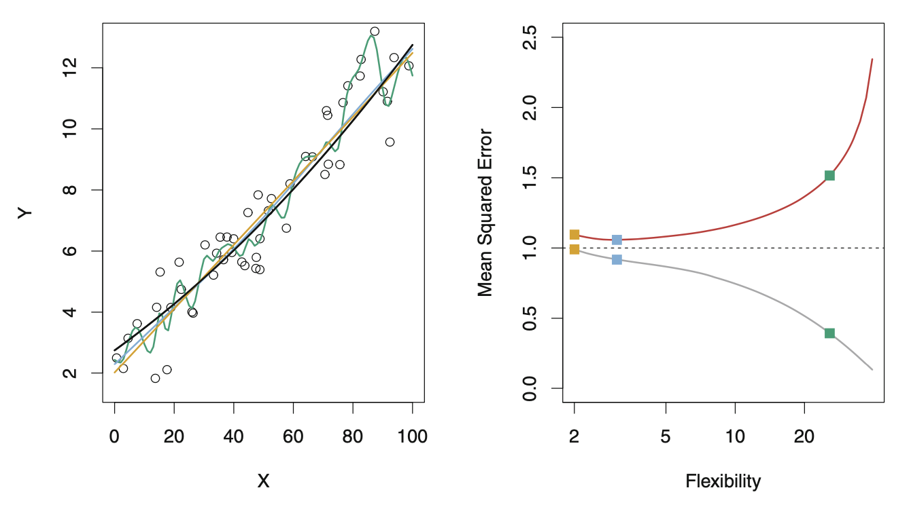
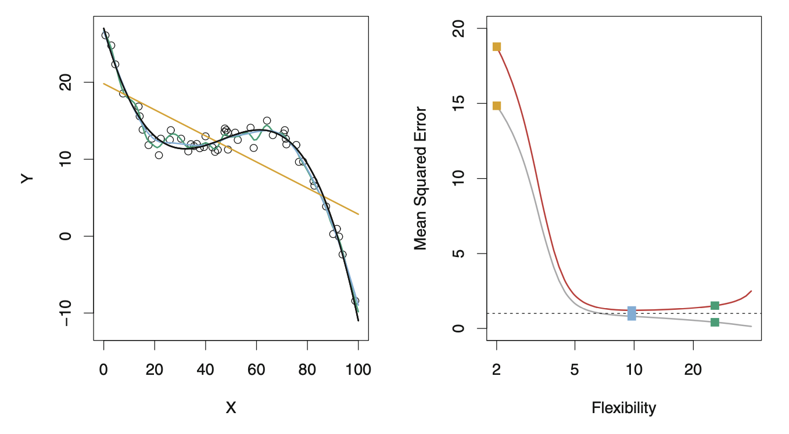
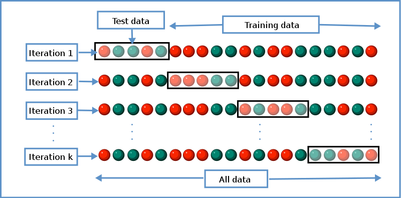

```{r}
#| label: setup
#| include: false
library(tidyverse)
library(gapminder)
library(knitr)
library(patchwork)
theme_set(theme_minimal(base_size = 18))
options(knitr.table.format = "html")
set.seed(42)
# Palette: viridis for the primary scale, magma for the second one.
v_dark <- "#440154"; v_blue <- "#31688e"; v_teal <- "#21918c"; v_green <- "#5ec962"
m_pink <- "#b73779"; m_purple <- "#8c2981"; m_orange <- "#fc8961"
# Week 1's frame, reproduced exactly (same seed, same split): 142 countries in
# 2007, 100 training, 42 held out.
gm <- gapminder |>
  filter(year == 2007) |>
  mutate(lgdp = log10(gdpPercap))
n <- nrow(gm)
test_id <- sample(n, 42)
train <- gm[-test_id, ]
test  <- gm[test_id, ]
knn_predict <- function(x0, x, y, k) {
  d <- abs(x - x0)
  mean(y[order(d)[1:k]])
}
```

## {.inverse}

### ST310: Machine Learning

Week 5: overfitting and validation

- What overfitting is, and why the training error cannot see it
- Two theorems: the optimism theorem, and the variance of a correlated average
- Validation and cross-validation: the protocol, and what a held-out score does and does not estimate

::: {.notes}
Timing, total 85 (the room is booked for 90; the rest is for questions). Opener, week 1's zero 3; what is overfitting, algorithms, great fitting, outline (the legacy opening) 3; the typical definition, lambda, the two ISLR figures, the end 4; generalization, two kinds, distributions 4; optimism and ID generalization (the setting) 2; three errors, three names 1; the board setup 1; the optimism theorem at the board 8; the covariance setup 1; the covariance identity and the trace at the board 6; degrees of freedom and the take-aways 2; two kinds of overfitting 1; week 1's 1997 question, the same countries in another world, in and out of distribution 6; from probability to statistics 1; the statistical segment (noise to statistical take-aways) 7; the philosophy segment 3; anthropology 1; validation divider 1; a held-out score is a mean of losses, and the twelve-errors ask 4; motives, choosing complexity, cross-validation, the cartoon, K-fold 6; the board setup 2; correlated-average variance at the board 5; lessons about cross-validation 3; leakage (the ask, the figure, the rule) 4; three kinds of data 2; two leaderboards 2; what a held-out score estimates 2; the summary and until the seminar 2. Reading is not spoken.

That line runs the legacy discussion slides at about a minute each; on the spine's two-minutes-a-slide scale the full deck is nearer 110. Cut order if short, with the minutes each saves at that pace: (1) the philosophy segment ("Considerations" to "Generalization, novelty, and severity"), the standing cut (3, or 8 on the spine's scale); (2) anthropology (1/4); (3) the statistical segment narrated from "Statistical take-aways" alone, "What is noise?" to "Two data scientists diverged" skipped (5/10); (4) "Typical ML definition" and "The end" (2); (5) "Two leaderboards" said in one sentence from the three-kinds-of-data slide (2); (6) "Motives" read, not discussed (1); (7) the trace half of the covariance board left to the seminar (problem 2 keeps it) (2). Does not move: the two boards and their asks and backups; the held-out standard error; K-fold defined before the correlated-average board; leakage; the three kinds of data; the same-countries figure; the closing ask.

Pace: 0:16 the generalization slides done, the board setup on screen. 0:27 the optimism theorem boxed. 0:36 the covariance identity boxed and week 1's zero explained. 0:45 the same-countries figure. 0:56 the validation divider. 1:05 K-fold defined, the correlated-average board starts. 1:12 the correlated-average variance boxed. 1:23 the closing ask.

Board scripts: instructor project, week 5, board_optimism_theorem and board_correlated_average.
:::

## Week 1, at the end

::: {.retrieval}
Your 1-NN submission had training error zero. What is that number measuring, and what would the competition have scored instead?
:::

::: {.ask}
One line each, written down. Then keep it: today answers the first question with a theorem and the second with a number.
:::

::: {.notes}
Two minutes, then two people read out. Collect, do not resolve: the whole first half of the lecture is the answer (the training error is optimistic, by a theorem; for 1-NN by exactly 2 sigma squared, on the covariance slide). The second question's answer, the held-out score, is week 1's leaderboard and comes back with its standard error after the validation divider. Say that problem set 1 is due this week.
:::

## What *is* overfitting?

### You've probably heard about it

### I've delayed it intentionally

I want to do justice to this extremely important, central concept of machine learning

And I'm dissatisfied with the usual definitions!

## {.inverse .center}

### Machine learning

#### is about algorithms

#### that allow us to increase model complexity

and optimize

on larger datasets

over larger sets of parameters

and even infinite-dimensional function spaces

## With great fitting comes great responsibility

ML increases danger of this specific kind of modeling problem

::: {.columns}
::: {.column width="50%"}
{height="330"}

Source: [Wikipedia](https://en.wikipedia.org/wiki/Overfitting)
:::
::: {.column width="50%"}
```{r}
#| label: gapminder-loess
#| out-width: "100%"
#| fig-width: 5.5
#| fig-height: 3.6
gdp_data <- gapminder |> filter(year == max(year))
ggplot(gdp_data, aes(x = gdpPercap, y = lifeExp)) +
  geom_point(aes(color = continent, shape = continent, size = pop)) +
  scale_colour_viridis_d(end = 0.9) +
  stat_smooth(formula = y ~ x, method = "loess", span = 1, colour = m_pink) +
  theme(legend.position = "none")
```
Example in week 1
:::
:::

::: {.notes}
The legacy slide linked the week-1 loess figure from the old site; that file is gone, so the figure is redrawn here from the same code (week 1's "Plot" tab, legend dropped for space). The Wikipedia figure is the legacy image, loaded from Wikipedia as before.
:::

## Outline {.inverse}

- **Complexity**: typical machine learning definition

- **Generalization**: simple probabilistic definition

- **Bias-variance**: statistical distinctions

- **Causality**: scientific/philosophical applications

- **Anthropology**: human learning and overfitting IRL (*supplemental but brief and useful for life in general?*)

- **Validation**: standard method to prevent overfitting (*to variation*, cannot help us with bias)

## Typical ML definition of overfitting {.inverse .center}

Motivating idea: assume the model will be "deployed"

I.e. Some time after fitting the model will be used on new data

> "It is difficult to make predictions, especially about the future" - [Danish saying](https://quoteinvestigator.com/tag/niels-bohr/)

## Overfitting the "training data"

Using a model that is *too complex*

Specifically, one where the complexity is larger than the optimal complexity for predicting on a *new observation* or *new sample* of **test/validation data**

- $\hat f_\lambda$ model fitted/estimated on **training data**

- $\lambda$ tuning parameter that *penalizes* complexity
  - larger $\lambda$, simpler model

- $\lambda^*$ optimal param. value for predicting/classifying *new data*

- Overfitting: using $\hat f_\lambda$ for some $\lambda < \lambda^*$

## ISLR Figure 2.10

::: {.columns}
::: {.column width="50%"}
True model is simple
:::
::: {.column width="50%"}
High complexity overfits
:::
:::

{height="440"}

## ISLR Figure 2.11

::: {.columns}
::: {.column width="50%"}
True model is complex
:::
::: {.column width="50%"}
Low complexity underfits
:::
:::

{height="440"}

## The end

Most discussions of overfitting end there

::: {.columns}
::: {.column width="50%"}
Some go on a little more, relating it to **bias-variance** trade-off

Overfitting: *low bias but overwhelmingly high-variance*

(we'll do that soon)
:::
::: {.column width="50%"}
{height="300"}
:::
:::

## Generalization {.inverse .center}

and a

### probabilistic definition

Motivation: what is the *probability distribution* of the test data?

## Two kinds of generalization

ML/AI books/courses talk about "generalization error"

Over-used term, same word / *importantly different* meanings

### Generalization to a new observation from...

- the same distribution or DGP
- a different (but related) distribution

and *corresponding reasons for doing poorly*

- variance ("random/unstructured error", high entropy)
- bias ("systematic/structured error", low entropy)

## Think about distributions

Suppose the training data is sampled i.i.d. from
$(\mathbf X_1, y_1), (\mathbf X_2, y_2), \ldots, (\mathbf X_n, y_n) \sim F$

and the test data is sampled i.i.d. from $(\mathbf X'_1, y'_1), (\mathbf X'_2, y'_2), \ldots, (\mathbf X'_{n'}, y'_{n'}) \sim F'$

#### In-distribution (ID) generalization: $F = F'$

Under/overfitting, **variability problem**, larger $n$ allows more complex models to be fit

#### Out-of-distribution (OOD) generalization: $F \neq F'$

"Covariate/distribution/dataset shift", **bias problem**, larger $n$ may not help. Need **modeling assumptions** like $F' \approx F$

## Optimism and ID generalization

Observation: training error generally appears lower than test/validation error. Why?

Risk vs *empirical* risk minimization

$$R(f) = \mathbb E\,\ell(Y, f(X))$$

$$\hat f = \arg \min_{f \in \mathcal F} \hat R_n(f) = \arg \min_{f \in \mathcal F} \frac{1}{n} \sum_{i=1}^n \ell(y_i, f(x_i))$$

Two results today. A theorem: the gap has a sign, for any class $\mathcal F$ and any new data from $F$. Then a formula: its size, for the fits we know, at the training inputs

::: {.notes}
The legacy slide stated a "Fact" here (optimism equals 2 sigma squared times degrees of freedom over n); it is now derived at the board, after the theorem, with the in-sample and extra-sample quantities kept apart. Symbols as in week 2's three-errors slide, retrieved on the next slide.
:::

## Three errors, three names

::: {.retrieval}
Week 2: the **population risk** $R(f) = \mathbb E\,\ell(Y, f(X))$; the **training error** $\hat R_n(f) = \frac1n\sum_{i=1}^n \ell(y_i, f(x_i))$; the **test error** $\widehat{\text{Err}} = \frac1m\sum_{j=1}^m \ell(y_j^{\text{test}}, \hat f(x_j^{\text{test}}))$, week 1's leaderboard. "Least squares minimizes $\hat R_n$ over the lines. Whether $R(\hat f)$ is then small is another matter."
:::

::: {.recall}
Week 4's symbols, with the table's wording: $\mathcal F$ is a class of predictors (the lines; the polynomials of degree 5; the $k$-NN fits for one $k$); $f_{\mathcal F}$ is the best in it, the minimizer of $R$ over $\mathcal F$. The empirical risk minimizer $\hat f$ minimizes $\hat R_n$ over $\mathcal F$, so $\hat f \in \mathcal F$.
:::

::: {.notes}
One minute. The three names from week 2's slide of the same title, and the two symbols week 4 owns; week 4 is being built in parallel, so they are introduced here with the notation table's wording and the consistency pass reconciles the two decks. The last line of the retrieval box is what the board resolves.
:::

## What the training error hides [board]{.board}

Training data $(x_i, y_i)$, $i = 1, \ldots, n$, independent draws of $(X, Y)$ from the population $F$; $\hat f$ the empirical risk minimizer over $\mathcal F$; $f_{\mathcal F}$ the best in $\mathcal F$.

::: {.ask}
Three numbers: $\mathbb E[\hat R_n(\hat f)]$, $R(f_{\mathcal F})$, $\mathbb E[R(\hat f)]$. Put them in order, and write down what you used to do it.
:::

::: {.notes}
Board script: instructor project, week 5, board_optimism_theorem. Two minutes for the ask; collect two orderings before going to the board. Why anyone cared: the training error is the only error you can compute without new data, and the theorem says which way it lies; the covariance slide says by how much. The next slide stays on the screen while you write.
:::

## Optimism theorem [board]{.board}

Training data i.i.d. from $F$; $\hat f$ the empirical risk minimizer over $\mathcal F$; $f_{\mathcal F}$ the best in $\mathcal F$ (risks finite, minimizers exist). Then
$$
\mathbb E\big[\hat R_n(\hat f)\big] \;\le\; R(f_{\mathcal F}) \;\le\; \mathbb E\big[R(\hat f)\big]
$$

::: {.leave}
Training error flatters the model. On average it sits below the best risk the class can reach, and the fitted model's risk sits above it. Week 1's zero was the left end of this line; the leaderboard estimates the right end.
:::

Week 3's confusion matrix, ROC curve and cost curve were computed on the model's 80 training points, and the seminar's on the 219 training birds. This is what that flattered.

::: {.notes}
Backups follow, uncounted. Three lines: the minimizer beats any fixed member on the training data; a fixed member's training error is unbiased for its risk (this is where i.i.d. sampling is used); the fitted model is a member, so its risk is at least the best. R of f-hat is the risk of the fitted function, a random variable; its expectation is over training sets. Nothing here fixes the inputs: the theorem is extra-sample, about new draws from F. The middle number is the excess-risk floor of week 4's ERM decomposition; the gap between the outer two is the optimism. If a student asks about early-stopped gradient descent: the left inequality needs the exact minimizer over F; a stopped iterate is not one, and the sign can fail. The week-3 line is the hook the week-3 data note left open ("the validation week says what that flatters"); one sentence, no more.
:::

## Optimism theorem, line 1 {.backup visibility="uncounted"}

$\hat f$ minimizes $\hat R_n$ over $\mathcal F$, and $f_{\mathcal F} \in \mathcal F$, so for every training set
$$
\hat R_n(\hat f) \le \hat R_n(f_{\mathcal F})
$$
Take expectations over training sets:
$$
\mathbb E\big[\hat R_n(\hat f)\big] \le \mathbb E\big[\hat R_n(f_{\mathcal F})\big]
$$

## Optimism theorem, line 2 {.backup visibility="uncounted"}

$f_{\mathcal F}$ is a fixed function, chosen before the data. Its training error is an average of $n$ losses $\ell(y_i, f_{\mathcal F}(x_i))$, each with mean $R(f_{\mathcal F})$ because $(x_i, y_i)$ is a draw from $F$:
$$
\mathbb E\big[\hat R_n(f_{\mathcal F})\big] = \frac1n\sum_{i=1}^n \mathbb E\,\ell(y_i, f_{\mathcal F}(x_i)) = R(f_{\mathcal F})
$$

This is the only place the sampling assumption is used, and it fails exactly when the data are not draws from $F$. (Independence is not needed for this line; identical distribution is.)

## Optimism theorem, line 3 {.backup visibility="uncounted"}

$\hat f \in \mathcal F$, so for every training set its risk is at least the best in the class:
$$
R(\hat f) \ge R(f_{\mathcal F})
$$
Take expectations: $\mathbb E[R(\hat f)] \ge R(f_{\mathcal F})$. Put the three lines together:
$$
\mathbb E\big[\hat R_n(\hat f)\big] \le R(f_{\mathcal F}) \le \mathbb E\big[R(\hat f)\big] \qquad \blacksquare
$$

$R(\hat f)$ is the risk of the fitted function: $\mathbb E[\ell(Y, \hat f(X)) \mid \text{training data}]$, a random variable. The gap $\mathbb E[R(\hat f)] - \mathbb E[\hat R_n(\hat f)] \ge 0$ is the **optimism** of the training error. (ESL §7.4 has the in-sample version; the class-and-minimizer form is PPA ch. 6.)

## How big is the gap? [board]{.board}

The theorem gives a sign. For the size, fix the inputs and let only the noise be random:

$y_i = f^\star(x_i) + \varepsilon_i$, inputs fixed, $\varepsilon_i$ independent, mean $0$, variance $\sigma^2$ (week 1's model). The fit $\hat y_i = \hat f(x_i)$ is built from **all** of $y_1, \ldots, y_n$.

A fresh outcome at the **same** input: $y_i^{\text{new}} = f^\star(x_i) + \varepsilon_i^{\text{new}}$, independent of everything the fit used.

::: {.ask}
The same squared error, at the same inputs, with the fresh outcomes in place of the training outcomes: bigger or smaller than the training error, on average, and by how much? Commit to a formula in the symbols on this slide.
:::

::: {.notes}
One minute, then the board (second half of board_optimism_theorem). The confusing part is the setting, not the algebra, so say each clause with a finger on the symbols: the x's are fixed; the y's would move if we redrew the noise; the fit moves with them, which is why the fit and the noise are correlated; the fresh y at the same x is a draw the fit has never seen. Week 1's problem 3 is the whole thing: E of epsilon times g is zero when g was built from other data, and not when the point is a training point.
:::

## Optimism, measured [board]{.board}

Inputs fixed, $y_i = f^\star(x_i) + \varepsilon_i$ as above, $\hat y_i = \hat f(x_i)$, $y_i^{\text{new}}$ a fresh outcome at $x_i$. Expected error at the training inputs with new outcomes, minus expected training error:
$$
\mathbb E\Big[\frac1n\sum_{i=1}^n (y_i^{\text{new}} - \hat y_i)^2\Big] - \mathbb E\big[\hat R_n(\hat f)\big] = \frac{2}{n}\sum_{i=1}^n \mathrm{Cov}(\hat y_i, y_i)
$$

::: {.leave}
The training error is optimistic by twice the average covariance between each fitted value and its own outcome: the fit peeks at its own noise. For a linear smoother $\hat{\mathbf y} = \mathbf H\mathbf y$ with $\mathbf H$ fixed: $2\sigma^2\,\mathrm{tr}(\mathbf H)/n$, and $\mathrm{tr}(\mathbf H)$ is the **degrees of freedom** of the smoother.
:::

::: {.notes}
Backups follow, uncounted. This is new y's at the old x's: in-sample. The competition and deployment have new x's too, and the theorem, not this formula, is what covers them; do not claim the formula for the held-out error. For the fits we own the covariance is nonnegative (a point pulls its own fit toward itself); it is not a law for every response-dependent procedure. Random inputs: condition on the x's and the identity holds as written, then average over x if you like; what changes is the target, not the algebra. Least squares: tr(H) is the number of columns of X, the intercept counted, week 2's problem 3 (q = p + 1 there). Nearest neighbors: H_ii = 1/k, tr(H) = n/k, and at k = 1 the gap is exactly 2 sigma squared while the training error is exactly zero: week 1's opening question, answered.
:::

## Optimism, measured, lines 1--2 {.backup visibility="uncounted"}

Write $f_i = f^\star(x_i)$. One term of the fresh-outcome error, add and subtract $f_i$:
$$
\mathbb E(y_i^{\text{new}} - \hat y_i)^2 = \mathbb E(\varepsilon_i^{\text{new}})^2 + \mathbb E(f_i - \hat y_i)^2 + 2\,\mathbb E\big[\varepsilon_i^{\text{new}}(f_i - \hat y_i)\big] = \sigma^2 + \mathbb E(f_i - \hat y_i)^2
$$
The cross term is zero: $\varepsilon_i^{\text{new}}$ has mean $0$ and is independent of everything that made $\hat y_i$ (week 1's problem 3(a)).

The same term of the training error:
$$
\mathbb E(y_i - \hat y_i)^2 = \sigma^2 + \mathbb E(f_i - \hat y_i)^2 + 2\,\mathbb E\big[\varepsilon_i(f_i - \hat y_i)\big]
$$
and now the cross term does **not** vanish: $\hat y_i$ was built from $\varepsilon_i$ (problem 3(b)).

## Optimism, measured, lines 3--4 {.backup visibility="uncounted"}

$f_i$ is a constant and $\mathbb E\varepsilon_i = 0$, so
$$
\mathbb E\big[\varepsilon_i(f_i - \hat y_i)\big] = -\mathbb E[\varepsilon_i \hat y_i] = -\mathrm{Cov}(y_i, \hat y_i)
$$
(the covariance of $y_i = f_i + \varepsilon_i$ with $\hat y_i$ is the covariance of $\varepsilon_i$ with $\hat y_i$, and $\mathbb E[\varepsilon_i \hat y_i] = \mathrm{Cov}(\varepsilon_i, \hat y_i)$ because $\varepsilon_i$ has mean zero).

Subtract the training term from the fresh term, average over $i$:
$$
\mathbb E\Big[\frac1n\sum_i (y_i^{\text{new}} - \hat y_i)^2\Big] - \mathbb E\Big[\frac1n\sum_i (y_i - \hat y_i)^2\Big] = \frac2n\sum_i \mathrm{Cov}(\hat y_i, y_i) \qquad \blacksquare
$$

## Optimism, measured, the trace {.backup visibility="uncounted"}

A linear smoother, $\hat{\mathbf y} = \mathbf H\mathbf y$ with $\mathbf H$ not depending on $\mathbf y$ (least squares; $k$-NN with the inputs fixed); the $y_j$ independent, variance $\sigma^2$:
$$
\mathrm{Cov}(\hat y_i, y_i) = \mathrm{Cov}\Big(\sum_j H_{ij} y_j,\; y_i\Big) = H_{ii}\,\sigma^2, \qquad \sum_i \mathrm{Cov}(\hat y_i, y_i) = \sigma^2\,\mathrm{tr}(\mathbf H), \qquad \text{optimism} = \frac{2\sigma^2\,\mathrm{tr}(\mathbf H)}{n}
$$

- Least squares: $\mathrm{tr}(\mathbf H)$ is the number of columns of $\mathbf X$, the intercept counted (week 2's problem 3: $q = p + 1$)
- $k$-NN: a point is its own nearest neighbor, $H_{ii} = 1/k$, $\mathrm{tr}(\mathbf H) = n/k$; at $k = 1$, optimism $2\sigma^2$ and training error $0$
- Mallows' $C_p$: training error $+\, 2\hat\sigma^2\,\mathrm{tr}(\mathbf H)/n$ (ESL §7.5)

## Optimism, ID gen., and degrees of freedom

#### Linear case

If $\hat f$ is linear with $p$ predictors (or $p$ basis function transformations of original predictors) then, with the intercept counted,

$$
\text{df}(\hat f) = \mathrm{tr}(\mathbf H) = p + 1
$$

the number of columns of $\mathbf X$ (week 2's trace). Nearest neighbors: $\text{df} = n/k$

#### Fairly general case

For many ML tasks and fitting procedures

$$\text{df}(\hat f) \text{ increases as } \frac{1}{n \sigma^2_\varepsilon} \sum_{i=1}^n \text{Cov}(\hat f (\mathbf x_i), y_i) \text{ increases}$$

::: {.notes}
Legacy slide; the linear case read df = p. It now counts the intercept, following week 2's slides and seminar (X has a column of ones, tr(H) = p + 1), and names the nearest-neighbor case. The notation table's "n by p" is flagged in CHANGES.md.
:::

## Take-aways about optimism and ID gen.

- Empirical risk *underestimates* actual risk (ID generalization error)

- The magnitude of this bias is called **optimism**

- Optimism generally increases with function class complexity

  - e.g. for linear functions, increases linearly in $p$

- For a fixed function class, optimism decreases linearly in $n$

- Too much optimization $\to$ overfitting $\to$ more optimism

## The covariance, measured {.backup visibility="uncounted"}

::: {.columns}
::: {.column width="55%"}
```{r}
#| label: optimism-sim
#| out-width: "100%"
#| fig-height: 4
#| fig-width: 6.4
set.seed(7)
n_s <- 50; sigma_s <- 1; reps <- 300
opt <- map_dfr(c(1, 3, 5, 8, 10, 15, 20, 25, 30), function(q) {
  X <- cbind(1, matrix(rnorm(n_s * (q - 1)), n_s, q - 1))
  fx <- X %*% rnorm(q); H <- X %*% solve(crossprod(X), t(X))
  out <- replicate(reps, {
    y <- fx + rnorm(n_s, sd = sigma_s); yhat <- H %*% y; y0 <- fx + rnorm(n_s, sd = sigma_s)
    c(training = mean((y - yhat)^2), `fresh outcomes` = mean((y0 - yhat)^2))
  })
  tibble(q = q, error = rownames(out), value = rowMeans(out))
})
theory <- tibble(q = 1:30) |>
  mutate(training = 1 - q / n_s, `fresh outcomes` = 1 + q / n_s) |>
  pivot_longer(-q, names_to = "error")
ggplot() +
  geom_line(data = theory, aes(q, value, colour = error), linewidth = 1) +
  geom_point(data = opt, aes(q, value, colour = error), size = 2.6) +
  scale_colour_manual(values = c(`fresh outcomes` = v_blue, training = m_pink)) +
  labs(x = "columns of X, q (n = 50)", y = "mean squared error", colour = NULL) +
  theme(legend.position = "top")
```
:::
::: {.column width="45%"}
Least squares, $n = 50$, $\sigma^2 = 1$, the model correct, $q$ columns with the intercept

Points: 300 simulated training sets each. Lines: $\sigma^2(1 - q/n)$ and $\sigma^2(1 + q/n)$; the gap is $2\sigma^2 q/n$, the formula exactly

Each column buys the fit a little more of its own noise. The seminar derives the two lines (problem 2)
:::
:::

## Two kinds of overfitting?

Many sources identify overfitting as a threat to generalization

Typically only apply this to **ID generalization**, and have solution strategies to avoid the **variability problems** due to overfitting

#### But overfitting is also a threat to **OOD generalization**!

This kind of generalization is often what we practically want

There are serious **bias problems** due to overfitting

#### Let's start using new terminology

*Overfitting to variation* and *overfitting to bias*

## Week 1, at the end (2)

::: {.retrieval}
Suppose we fit a model to the 142 countries in 2002 and test it on the *same 142 countries in 1997*, and it does well. Has it predicted anything new?

(The seminar ran it: the line fitted on the 2007 training countries, scored on 1997.)
:::

::: {.ask}
Which of the two kinds of generalization did that test, and what would a test of the other kind look like? Write it down.
:::

::: {.notes}
Two minutes, then two people. Week 1's seminar answered "the same countries ten years earlier: stability over time, not new countries", and week 2's opener stopped at "the rows were nearly the training rows". Today finishes it: the next slide shows what a random split tests and what the same countries in another year test, and the slide after gives the vocabulary. Do not give either before the figure.
:::

## Same countries, another world

```{r}
#| label: same-countries
#| out-width: "100%"
#| fig-height: 3.9
#| fig-width: 12
line07 <- lm(lifeExp ~ lgdp, data = train)
held07 <- test |> mutate(pred = predict(line07, newdata = test))
same52 <- gapminder |>
  filter(year == 1952, country %in% test$country) |>
  mutate(lgdp = log10(gdpPercap))
same52 <- same52 |> mutate(pred = predict(line07, newdata = same52))
rm07 <- sqrt(mean((held07$lifeExp - held07$pred)^2))
rm52 <- sqrt(mean((same52$lifeExp - same52$pred)^2))
bias52 <- mean(same52$lifeExp - same52$pred)
base_plot <- function() ggplot() +
  geom_point(data = train, aes(lgdp, lifeExp), colour = "grey70", size = 1.8) +
  geom_abline(intercept = coef(line07)[1], slope = coef(line07)[2], colour = v_blue, linewidth = 1.1) +
  ylim(25, 85)
pa <- base_plot() +
  geom_point(data = held07, aes(lgdp, lifeExp), colour = m_pink, size = 2.4) +
  labs(x = "log10 GDP per capita", y = "life expectancy",
       title = sprintf("42 held-out countries, 2007: RMSE %.1f years", rm07)) +
  theme(plot.title = element_text(size = 15))
pb <- base_plot() +
  geom_point(data = same52, aes(lgdp, lifeExp), colour = v_dark, size = 2.4) +
  labs(x = "log10 GDP per capita", y = NULL,
       title = sprintf("the same 42 countries, 1952: RMSE %.1f years", rm52)) +
  theme(plot.title = element_text(size = 15))
pa + pb
```

Week 1's line, fitted on the 100 training countries in 2007. Left: scored on the 42 held-out countries, a random split of the same year. Right: the same 42 countries in 1952, where it is `r sprintf("%.0f", -bias52)` years too optimistic on average. Nothing in the left panel could have warned you

::: {.notes}
The left panel is week 1's leaderboard for the line (same seed, same split). The right panel is the same 42 countries 55 years earlier: at the same income, people lived shorter lives, for reasons that are not in the model. Ten years earlier (the seminar's 1997 test) the world had barely moved, which is why that score was low; this is the same test pushed far enough to fail. What moved is the relation between income and life expectancy, p(y | x), not the countries. The RMSEs are for this split; the direction and the rough size of the 1952 gap are not. Sources: gapminder, 2007 and 1952.
:::

## In and out of distribution

**In distribution**: the new units are independent draws from the same $F$ as the training units. A random split of one dataset tests exactly this, for the unit you split by. The optimism theorem and the protocol (after the break) are the story

**Out of distribution**: $F' \ne F$, in one of two ways

- the inputs move: **covariate shift**, $p(x)$ changes and $p(y \mid x)$ does not. New countries at incomes never seen is the extreme case (week 2's extrapolation)
- the relation moves: $p(y \mid x)$ changes. The same income bought fewer years of life in 1952. More old data estimates the old relation better, not the new one

**Neither**: the same units again (week 1's 1997 test). A different question, stability over time; what it strains is the independence of the test units from the training units

::: {.notes}
Week 1's test was not a leak by definition; the course said in week 1 that it answers a different, legitimate question, and that stands. The vocabulary is ESL's and PPA's; week 10 returns to covariate shift with the identity that reweights a training loss into a deployment loss, and to what a fitted model can and cannot say when the relation moves. Today: the picture and the words.
:::

## Now let's jump from probability to statistics

And talk about why we always need to care about *both kinds of generalization*

{height="380"}

## Statistical aspects of overfitting {.inverse .center}

Motivation: all models are wrong, including $F$ and $F'$

or

Motivation: overfitting to noise... what's noise?

## What *is* noise?

The effect of all (causal?) factors not captured by the model

Could be different reasons for failing to capture

- Measurement issues
- Wrong functional relationship
- Variables excluded (maybe not even measured or defined)

*Does not require physical randomness* (which maybe doesn't exist...)

Something considered **noise** in one setting, or by one modeler, could be **signal** to a different observer

## Noise and residuals in regression

(*One of the most "agnostic" or minimal-theory ways of defining regression is as estimation of a conditional expectation function, without assuming any specific functional form like linearity*). The "noise" in regression is defined as

$$
\varepsilon = y - \mathbb E_F[y | \mathbf x]
$$

But this is math, not applied data analysis! Requires assuming a probability distribution $F$ / random variable model

Otherwise, how do we define expectation?

We never observe $\varepsilon$, only residuals $r_i = y_i - \hat f(\mathbf x_i)$ of some model $\hat f$ *fit with specific assumptions/algorithms*

## What is bias/variability?

Two analysts start with different assumptions

e.g. linearity vs flexible non-parametric methods

Fit different regression functions

Compute different residuals

See different patterns (or lack thereof) in residuals

Something considered **variation** in one setting, or by one modeler, could be **bias** to a different observer

## Data science

In the "real world" there is a data generation process (DGP)

We *assume* this can be modeled as an i.i.d. sample from a probability distribution $F$

Probability model / mathematical justification for our methods

#### All models are wrong

Could model DGP as a mixture of distributions $F$ and $F'$ (heterogeneity), or time-varying $F^t$

Training/test data randomly shuffled?

Generalization in/out of distribution?

## Two data scientists diverged...

Starting with different assumptions about DGP

Use different strategies to avoid overfitting

e.g. different ways of splitting into training and test data

Something considered **ID generalization** in one setting, or by one modeler, could be **OOD generalization** to a different observer

## Statistical take-aways

Mathematical distinctions between ID and OOD generalization rely on assumptions (as do statistical distinctions between bias and variability)

ML methods for avoiding overfitting are motivated by ID generalization, guard against **overfitting to variability**

In applications, ID/OOD distinctions break down. If we probe them a bit we find it's more gray area / ambiguous

Most scientists and decision-makers care about [external validity](https://en.wikipedia.org/wiki/External_validity), conceptually related to OOD generalization

**Overfitting to bias** is a serious, widely neglected problem!

## Considerations {.inverse .center}

of the

### scientific and philosophic variety

#### with respect to overfitting

Motivation: does science overfit? Can philosophy of science help us understand how to prevent it? What about causality?

::: {.notes}
The standing cut: this divider and the next three slides.
:::

## Stability, invariance, and causality

**Idea**: causal relationships should persist despite (some) [changes](https://plato.stanford.edu/entries/causation-counterfactual/#ConInv) in "[background](https://static1.squarespace.com/static/54023011e4b00d99c7bb97f9/t/547b5b1fe4b0464e56d755b4/1417370399799/PoS1997.pdf) [conditions](https://static1.squarespace.com/static/54023011e4b00d99c7bb97f9/t/5445ceb4e4b06ae793389dad/1413861044101/BandP2010.pdf)"

[Bradford Hill criteria](https://en.wikipedia.org/wiki/Bradford_Hill_criteria) for causation

> **Consistency**: Has [the observed association] been repeatedly observed by different persons, in different places, circumstances and times?

Apparently [people think about causality](https://onlinelibrary.wiley.com/doi/pdf/10.1111/cogs.12605) this way

Can use the idea to motivate [statistical methods](https://rss.onlinelibrary.wiley.com/doi/full/10.1111/rssb.12167) for causal inference

## Overfitting as a threat to causal inference

[Bradford Hill criteria](https://en.wikipedia.org/wiki/Bradford_Hill_criteria) for causation

> "the larger the association, the more likely that it is causal." - Wikipedia, not Hill

Hill:

> the death rate from cancer of the lung in cigarette smokers is nine to ten times the rate in non-smokers

**Problem**: overfitting can make associations appear stronger

e.g. proportion of variation in `lifeExp` explained by `gdpPercap`

Increase flexibility, explain higher proportion... stronger evidence of causality? 🤔

## Generalization, novelty, and severity

[Philosophy of science](https://plato.stanford.edu/entries/prediction-accommodation/): prediction vs "accommodation"

Prediction: happens in time before observation/measurement

Accommodation: theory built to explain past observation/data

Accurate prediction is better evidence in favor of a scientific theory than mere accommodation

ML: What's better evidence in favor of the model?

Popper and Lakatos: **temporal novelty**

Zahar, Gardner, Worrall: **use-novelty** (or problem novelty)

[Mayo](http://bactra.org/reviews/error/): novelty is not necessary. **Severity** is necessary

## Anthropology? {.inverse .center}

### ie. overfitting IRL

(in real life)

Motivation: do *we* overfit? ("Are we the baddies?")

Disclaimer: I am not an anthropologist *or* self-help author

## How/why are humans different?

We seem to better at *learning* than other animals

[Human eyes are different](https://en.wikipedia.org/wiki/Cooperative_eye_hypothesis), allowing us to see where others are looking

### Social learning

#### "Monkey see, monkey do"

Lots of animals learn by [imitation](https://en.wikipedia.org/wiki/Imitation#Over-imitation), but [humans specifically](https://psycnet.apa.org/fulltext/1993-44247-001.pdf) take imitation to a [whole](https://journals.plos.org/plosone/article?id=10.1371/journal.pone.0159920) [different](https://www.pnas.org/content/104/50/19751) level

#### Over-imitation, causal opacity, cultural evolution...

## Validation {.inverse .center}

### Estimate test error directly

#### using "**validation data**" / "**test data**"

##### i.e. a new set of data, "unseen" by $\hat f$

Indep. samples $D = \{  (\mathbf x_i, y_i) \}_{i=1}^n$ and $D' = \{ (\mathbf x_i', y_i') \}_{i=1}^{n'}$

Estimate $\hat f$ on $D$, evaluate $\hat f$ on $D'$

## A held-out score is a mean of losses

```{r}
#| label: leaderboard
#| out-width: "68%"
#| fig-height: 2.6
#| fig-width: 10
mse_se <- function(pred, y) {
  l <- (y - pred)^2
  c(mean(l), sd(l) / sqrt(length(l)))
}
preds <- list(
  "baseline: one number for everyone" = rep(mean(train$lifeExp), nrow(test)),
  "1 nearest neighbor" = sapply(test$lgdp, knn_predict, x = train$lgdp, y = train$lifeExp, k = 1),
  "5 nearest neighbors" = sapply(test$lgdp, knn_predict, x = train$lgdp, y = train$lifeExp, k = 5),
  "10 nearest neighbors" = sapply(test$lgdp, knn_predict, x = train$lgdp, y = train$lifeExp, k = 10)
)
lb <- map_dfr(names(preds), function(nm) {
  r <- mse_se(preds[[nm]], test$lifeExp)
  tibble(competitor = nm, mse = r[1], se = r[2])
}) |> mutate(competitor = fct_reorder(competitor, -mse))
ggplot(lb, aes(mse, competitor)) +
  geom_errorbar(aes(xmin = mse - se, xmax = mse + se), width = 0.25, colour = "grey60", orientation = "y") +
  geom_point(size = 4, colour = v_dark) +
  labs(x = "test MSE on the 42 held-out countries", y = NULL,
       title = "Week 1's leaderboard; bars: one standard error") +
  theme_minimal(base_size = 15)
```

Where did the bars come from? $m$ held-out units, losses $L_j = \ell(y_j^{\text{test}}, \hat f(x_j^{\text{test}}))$; with $\hat f$ held fixed, independent if the units are:
$$
\widehat{\text{Err}} = \frac1m\sum_{j=1}^m L_j, \qquad \text{SE} = \frac{\text{sd}(L)}{\sqrt m}
$$
The uncertainty of one fit's score on $m$ new units, not of refitting on a new training set

::: {.notes}
Derived, one line: the variance of a mean of independent terms, week 1's problem 2(a). Two things to say precisely, because the review of cc's version caught both: the losses are independent conditional on the fitted predictor, if the held-out units are independent draws (an assumption about the countries, not a fact about them); and the number is the uncertainty of this fit's score, not of the procedure over new training sets. This is the honest number and its honest uncertainty; the board after K-fold is about what happens when the pieces being averaged stop being independent.
:::

## Twelve errors in a hundred

::: {.ask}
A classifier makes 12 errors on 100 held-out cases. Its standard error? A rival makes 10 errors on the same 100 cases. Distinguishable?
:::

::: {.notes}
sqrt(0.12 times 0.88 / 100) = 0.032; the rival is 0.02 away, under one standard error; not distinguishable on this evidence. If someone says "same cases, so compare the paired losses": yes, and that is the right ruler (the seminar's problem 4 asks for it); the marginal bars are what a leaderboard shows. One minute.
:::

## Motives

- Debiasing risk estimate. Since $\hat f$ does not depend on $D'$, it is not **overfit to the variability** in $D'$

- If $\hat f$ is overfit to $D$ then its test error on $D'$ will be large (complexity too high, variability too high)

- Actual practice: analogous to "deploying an ML model in production"

- Philosophy of science: use novelty, actual prediction (not accommodation)

- Tukey: [Exploratory Data Analysis](https://en.wikipedia.org/wiki/Exploratory_data_analysis) vs Confirmatory

- Use test error to choose **model complexity** / **amount of regularization**

## Choosing model complexity

### Using test/validation data

Indep. samples $D = \{  (\mathbf x_i, y_i) \}_{i=1}^n$ and $D' = \{ (\mathbf x_i', y_i') \}_{i=1}^{n'}$

- Estimate $\hat f_\lambda$ on $D$ for a "path" or grid of $\lambda$ values

- Evaluate $\hat f_\lambda$ on $D'$ and choose $\hat \lambda$ accordingly (e.g. with minimum loss)

- Refit $\hat f_{\hat \lambda}$ on full data $D \cup D'$, this is our final model

*Common when computational cost of fitting one model is high*

## Cross-validation

*When computational cost of fitting one model is not too high*

**Idea**: swap $D$ and $D'$ in previous process and get two estimates, $\hat R(\hat f_\lambda)$ and $\hat R(\hat f_\lambda')$

Average these and choose $\hat \lambda$ using the average (e.g. minimizer)

**Idea**: apply the same process with multiple "folds" of data

#### $K$-fold cross-validation

Each subset used once as test set, and $K-1$ times for training

Minimize $\hat R_{K\text{-cv}}(\lambda) = \frac{1}{K} \sum_{k=1}^K \hat R_k(\hat f^{(k)}_\lambda)$

::: {.notes}
Legacy slide; it read "multiple independent folds", and "independent" is gone: the folds are disjoint, which is not the same thing, and the board in five minutes is about exactly that. This is where K-fold is defined; the board that needs it comes after the two slides that follow (the audit's item 5.1a).
:::

## Cross-validation cartoon

{height="300"}

Gives $K$ estimates of test error (risk) at each $\lambda$

Credit: [Wikipedia](https://en.wikipedia.org/wiki/Cross-validation)

## $K$-fold cross-validation

Each subset used once as test set, and $K-1$ times for training

Choose $\hat \lambda$ to minimize

$$\hat R_{K\text{-cv}}(\lambda) = \frac{1}{K} \sum_{k=1}^K \hat R_k(\hat f^{(k)}_\lambda)$$
where $\hat f^{(k)}_\lambda$ is fit on the dataset that "holds out" the $k$th fold

Then refit model $\hat f_{\hat \lambda}$ at that value of $\hat \lambda$ on the entire dataset

::: {.notes}
Two things to insist on: it is a way of choosing complexity, and the number at each lambda is the average of K scores of K different fits. The refit is why the final model is none of the K models. The seminar writes the loop, chooses k for nearest neighbors on the 100 training countries, and only then opens the vault.
:::

## $K$ numbers, one average [board]{.board}

$K$ fold scores $\hat R_1, \ldots, \hat R_K$, averaged. Software prints $\text{sd}(\hat R_k)/\sqrt K$ next to the average and draws it as a bar

::: {.retrieval}
Week 1's seminar, problem 2: $k$ independent terms, each with variance $\sigma^2$, the variance of the mean is $\sigma^2/k$; $k$ identical terms, no reduction at all.
:::

::: {.ask}
Between the two: $K$ variables, each with variance $\tau^2$, every pair with correlation $\rho$. Write down the variance of their mean before we start.
:::

::: {.notes}
Board script: instructor project, week 5, board_correlated_average. Week 1's answer deferred this exact case to "the tree-methods week"; it is proved here and week 9 retrieves it for bagging (CHANGES.md records the pointer). Collect two formulas, then the board; the next slide stays on the screen. The K fold scores are averages of squared errors of K fits that share most of their training rows: the K estimates are not independent draws, whatever the disjoint held-out blocks suggest. The board says what an average of dependent terms does, and then what that means for the bar.
:::

## Correlated-average variance [board]{.board}

$K$ random variables $V_1, \ldots, V_K$, each with variance $\tau^2$, every pair with correlation $\rho$:
$$
\mathrm{Var}\Big(\frac1K\sum_{k=1}^K V_k\Big) = \rho\,\tau^2 + (1 - \rho)\,\frac{\tau^2}{K}
$$

::: {.leave}
$\rho = 0$: week 1's $\tau^2/K$. $\rho = 1$: $\tau^2$, no reduction. In between, the $\rho\tau^2$ part does not shrink with $K$. The $K$ fold scores share training rows, so $\rho$ need not be $0$: $\text{sd}/\sqrt K$ is a heuristic, not a standard error. Week 9: averaging $B$ trees removes only the $(1 - \rho)$ part.
:::

::: {.notes}
Backup follows, uncounted. Two lines on the board: the variance of a sum is the sum of the variances plus the covariances, K of the first and K(K minus 1) of the second; divide by K squared. What the review of cc's version insists on, and it is right: overlap makes dependence possible, it does not fix the sign of rho or make sd over root K an understatement in every case (a constant learner gives rho equal to zero; a leave-one-out example in the board script gives a negative correlation), and the sample sd of the K scores is itself pulled by rho. Bengio and Grandvalet (2004) is the citation, scoped: no estimator of the K-fold variance is unbiased over all distributions. So: software's bars assume rho is zero; read them as a heuristic. The honest bar is the one on the previous board, m independent units the fit never saw. Then say what the average estimates: the expected error of the procedure at this lambda over training sets of this size, not the error of the one model you will refit.
:::

## Correlated-average variance, the two lines {.backup visibility="uncounted"}

The variance of a sum is the sum of all variances and covariances: $K$ terms $\mathrm{Var}(V_k) = \tau^2$ and $K(K - 1)$ terms $\mathrm{Cov}(V_k, V_l) = \rho\tau^2$, $k \ne l$. Then divide by $K^2$:
$$
\mathrm{Var}\Big(\sum_{k=1}^K V_k\Big) = K\tau^2 + K(K - 1)\rho\tau^2,
\qquad
\mathrm{Var}\Big(\frac1K\sum_{k=1}^K V_k\Big) = \frac{\tau^2}{K} + \frac{(K - 1)\rho\tau^2}{K} = \rho\tau^2 + (1 - \rho)\frac{\tau^2}{K} \qquad \blacksquare
$$

The sample sd of the $K$ scores is not $\tau$ either: with equal means and variances, $\mathbb E[s^2] = \tau^2(1 - \rho)$. Both halves of $\text{sd}/\sqrt K$ carry $\rho$.

## Lessons about cross-validation

- Think of it as a way to **choose model complexity**

- **Beware** common cross-validation errors! From Duda and Hart quoted in [MLstory](https://mlstory.org/data.html)

> ... the same data were often used for designing and testing the classifier. This mistake is frequently referred to as "testing on the training data." A related but less obvious problem arises *when a classifier undergoes a long series of refinements guided by the results of repeated testing on the same data. This form of "**training on the testing data**" often escapes attention until new test samples are obtained*.

## Lessons about cross-validation

- **Beware** common cross-validation errors! From ESL:

> Ideally, the test set should be kept in a "vault," and be brought out only at the end of the data analysis. *Suppose instead that we use the test-set repeatedly, choosing the model with smallest test-set error. Then the test set error of the final chosen model will underestimate the true test error*, sometimes substantially.

- Cross-validate entire model building pipeline (not just one step), and only do it once -- or at *least* not many times

- Choosing $K$: larger $\to$ $\hat R_{K\text{-cv}}$ has lower bias, more variance. Often use $K = 5$ or $10$

::: {.notes}
"Cross-validate the entire pipeline" is the next slide, with a number; "only do it once" is the slide after, the protocol, and the regularization week measures what happens when it is broken.
:::

## Leakage

$n = 100$ patients, $p = 2{,}000$ genes, every gene pure noise, labels 50/50.

I keep the 20 genes most correlated with the label, using all 100 patients, then run 5-fold cross-validation of a logistic regression on those 20.

::: {.ask}
Commit: the cross-validated error rate will be near 50%, or near 30%?
:::

::: {.notes}
ESL §7.10.2's "wrong way" example, rerun on the next slide. Take a show of hands for each; the room usually splits.
:::

## Leakage: a leak looks like success

```{r}
#| label: leakage
#| out-width: "100%"
#| fig-height: 2.9
#| fig-width: 11
set.seed(21)
nl <- 100; pl <- 2000; yl <- rep(0:1, each = 50); Z <- matrix(rnorm(nl * pl), nl, pl)
folds <- sample(rep(1:5, length.out = nl))
top20 <- function(Z, y) order(abs(cor(Z, y)), decreasing = TRUE)[1:20]
cv_err <- function(select_inside) sapply(1:5, function(k) {
  tr <- folds != k
  chosen <- if (select_inside) top20(Z[tr, ], yl[tr]) else top20(Z, yl)
  fit <- glm(yl[tr] ~ Z[tr, chosen], family = binomial)
  mean((plogis(cbind(1, Z[!tr, chosen]) %*% coef(fit)) > 0.5) != yl[!tr])
})
leak <- bind_rows(
  tibble(pipeline = "genes chosen on all rows, then cross-validation", fold = 1:5, error = cv_err(FALSE)),
  tibble(pipeline = "genes chosen inside each fold, on its training rows", fold = 1:5, error = cv_err(TRUE))
)
ggplot(leak, aes(error, pipeline, colour = pipeline)) +
  geom_vline(xintercept = 0.5, linetype = "dotted") +
  geom_point(size = 3.5, alpha = 0.85) +
  scale_colour_manual(values = c("genes chosen on all rows, then cross-validation" = m_pink,
                                 "genes chosen inside each fold, on its training rows" = v_blue)) +
  xlim(0, 0.7) +
  labs(x = "5-fold cross-validation error rate (one point per fold)", y = NULL) +
  theme(legend.position = "none")
```

The selection step saw the held-out rows' labels, so the folds were not held out from the whole pipeline. Pure noise, and a cross-validated error near 30%

**The rule**: every step that is *learned from data* (selecting features, standardizing, imputing, tuning) is fitted on the training rows of each fold and then applied to the held-out rows. Fixed transformations chosen in advance (a log, dropping a column by name) are exempt

::: {.notes}
Simulated: one run, seed 21; the leaky rate lands between 15 and 35 percent across seeds, the honest one between 40 and 60. The rule is stated as the review of cc's version asked: not "everything that touches the labels", because centering, scaling and imputation learned from the held-out rows leak without any outcome. In this example, standardizing all rows would change nothing (an invertible rescaling with an intercept leaves an unpenalized logistic fit's predictions where they were); the operative leak is the selection on the labels. Week 1's one rule (an input is fair game only if you would have it at the moment you need the prediction) is the same idea seen from the other side, and the next slide retrieves it. The seminar writes the honest loop first, then breaks it.
:::

## Three kinds of data, one rule each

::: {style="font-size: 0.95em"}
| | Used for | How often |
|---|---|---|
| **Training** | fitting | as much as you like |
| **Validation** (or the folds) | choosing among fits: $\lambda$, $k$, features, methods | as much as you like, knowing the winner's score is a selected minimum, and optimistic |
| **Test**, reserved | one number for the model you chose, with its standard error | **once** |

: {tbl-colwidths="[24,40,36]"}
:::

ESL's word for the third: keep it in a **vault**. Split once, at random, before looking; refit the chosen model on training plus validation; open the vault once; report that number, not the validation minimum, not the training error

::: {.retrieval}
Week 1's one rule: an input is fair game only if you would have it at the moment you need the prediction. Leakage is the same rule, applied to the evaluation data.
:::

::: {.notes}
The protocol in a table. The middle row's caveat is the seed for the regularization week: the minimum over candidates of a noisy score is biased down; how far depends on the noise and on how different the candidates are, not on the count alone. Today it is enough to say "a selected minimum". The third row is the one people break. An untuned pipeline with every learned step inside the folds is validly estimated by cross-validation without a vault; the vault is for the procedure that chose.
:::

## CTF competition: two leaderboards

**Netflix** (week 1): the public leaderboard was scored on one held-out subset (the "quiz" set); the prize was decided on another the teams never saw (the "test" set). The Ensemble led the quiz board by one point in the fourth decimal; on the test set the two teams tied, and twenty minutes decided a million dollars

**Kaggle**: most competitions keep a public leaderboard, updated with every submission, and a private one, revealed once at the end. Teams that tune to the public score drop when the private one is revealed. The community calls it the *shake-up*

The private leaderboard is the vault, run at industrial scale. A public score that has been submitted to a thousand times is a validation score

::: {.notes}
The two-subset structure promised in week 1's Netflix notes: quiz 0.8553 against 0.8554, test tied at 0.8567 to four decimals, the prize to the earlier submission. "Most" Kaggle competitions, not every one (some formats differ). The regularization week measures what a thousand submissions to the public board do to it (the adaptive-drift statement); today only the structure. PPA ch. 8 has the holdout method and Kaggle's secret holdout.
:::

## What a held-out score estimates

::: {.leave}
A held-out score estimates, with a standard error, the risk of the frozen predictor for the population the held-out units were drawn from: the same kind of unit, the same population, the same time. Whether the deployment population is that population is an argument you have to make; no split makes it for you
:::

::: {.ask}
Week 3's readmission model scored well on held-out patients. Name one way the hospital could deploy it that a random split cannot have tested.
:::

::: {.notes}
Expected: a different hospital or population (the inputs move); next year's patients, or a changed discharge policy (the relation moves); the model's own deployment changing behavior (week 3's closing question). Collect three; do not rank them. The word is "estimates", not "certifies": a held-out mean is an estimate with sampling error, and the standard error is part of the report.
:::

## {.inverse}

### Regularization

- Fancy sounding word for "simplification," simpler models
- Increases bias to reduce variance

### Cross-validation

- Fit and evaluate models on different subsets of data
- Choose amount of regularization/complexity
- Re-using data *more than once* $\to$ overfitting again

## Until the seminar

::: {.ask}
You tune $k$ for nearest neighbors by 5-fold cross-validation over 14 values of $k$. The smallest cross-validated MSE is 47.8. Your colleague writes "the model's error is 47.8" in the report.

In one sentence, why do you hesitate? In one more, what would you do instead?
:::

Bring it to the seminar; you will run exactly this on the 100 training countries, and then open the vault.

::: {.notes}
Expected: 47.8 is the smallest of 14 noisy averages, so it is optimistic for the k that was chosen, and it is an average over K fits, none of which is the model that will be reported; report the score of the refitted model on a reserved test set, with its standard error, or say what 47.8 is. The regularization week puts a size on the selection effect. Do not give the size today. Reading week next.
:::

## Reading

- ISLR ch. 5, section 5.1, pp. 197--209 (the validation set, leave-one-out and $K$-fold cross-validation, and the bias--variance trade-off in choosing $K$). Section 5.2, the bootstrap, is not part of this course.
- PPA ch. 6, pp. 100--106 (the generalization gap; what happens empirically with over-parameterized models), and ch. 8, pp. 146--148 (the holdout method; Kaggle's secret holdout).

Reading week: ISLR section 6.2, pp. 237--252 (ridge and the lasso), for the regularization week.

Deeper: ESL §7.4--7.6 (optimism, $C_p$, degrees of freedom), §7.10 (cross-validation, and the "wrong way" example), §7.12 (conditional or expected test error).
