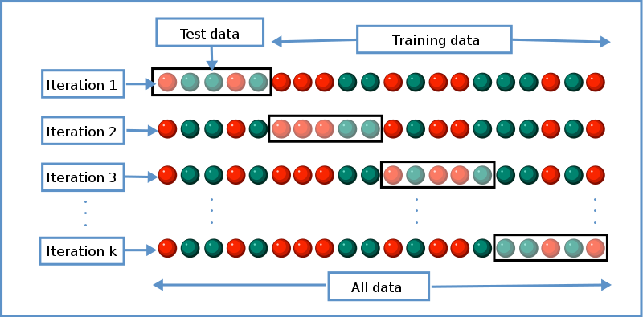
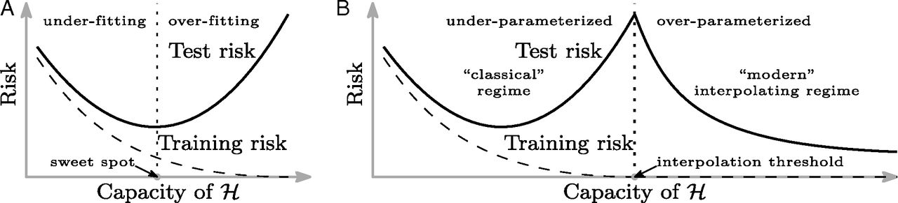

```{r}
#| label: setup
#| include: false
library(tidyverse)
library(knitr)
library(patchwork)
library(splines)        # ns(); ships with R
library(glmnet)
library(rpart)
library(mgcv)           # gam() with a penalty on wiggliness
library(gapminder)
theme_set(theme_minimal(base_size = 18))
options(knitr.table.format = "html")
options(digits = 5)
# Palette: viridis for the primary scale, magma for the second one.
v_dark <- "#440154"; v_blue <- "#31688e"; v_teal <- "#21918c"; v_green <- "#5ec962"
m_pink <- "#b73779"; m_purple <- "#8c2981"; m_orange <- "#fc8961"
mse <- function(y, pred) mean((y - pred)^2)
se_loss <- function(y, pred) sd((y - pred)^2) / sqrt(length(y))
# k-NN regression with several standardized inputs, as in the structures lecture: squared distances
# by matrix algebra, then the mean outcome of the k nearest training rows.
knn_predict <- function(Xnew, Xtrain, ytrain, k) {
  d2 <- outer(rowSums(Xnew^2), rowSums(Xtrain^2), "+") - 2 * Xnew %*% t(Xtrain)
  apply(d2, 1, function(d) mean(ytrain[order(d)[1:k]]))
}
# The task: Spotify tracks (data note: data/spotify.md), one row per track, split three ways exactly
# as in the structures lecture and its seminar: 5,000 training, 2,000 selection, 3,000 test tracks.
sp <- read_csv("../../../files/spotify_tracks.csv", show_col_types = FALSE) |>
  distinct(track_id, .keep_all = TRUE) |>
  mutate(duration_min = duration_ms / 60000, genre = factor(playlist_genre))
feat <- c("danceability", "energy", "loudness", "speechiness", "acousticness",
          "instrumentalness", "liveness", "valence", "tempo", "duration_min", "release_year")
set.seed(310)   # the deck's only seed: the split (the seminar's), then every random step below, in order
sp_id <- sample(nrow(sp))
sp_train <- sp[sp_id[1:5000], ]
sp_sel   <- sp[sp_id[5001:7000], ]
sp_test  <- sp[sp_id[7001:10000], ]
y_tr <- sp_train$track_popularity; y_se <- sp_sel$track_popularity
# The design with genre as dummies, standardized on the training tracks, for the penalized fits.
sp_X <- function(d) model.matrix(reformulate(c(feat, "genre"), "track_popularity"), d)[, -1]
sp_mu <- colMeans(sp_X(sp_train)); sp_sd <- apply(sp_X(sp_train), 2, sd)
sp_Xtr <- scale(sp_X(sp_train), sp_mu, sp_sd); sp_Xse <- scale(sp_X(sp_sel), sp_mu, sp_sd)
colnames(sp_Xtr) <- colnames(sp_Xse) <- sub("^genre", "genre: ", colnames(sp_X(sp_train)))
# The eleven numeric inputs standardized, for k-NN (as in the structures lecture's baselines).
stdz <- function(d, mu, s) sweep(sweep(as.matrix(d[, feat]), 2, mu), 2, s, "/")
mu_f <- colMeans(sp_train[, feat]); sd_f <- apply(sp_train[, feat], 2, sd)
X_tr <- stdz(sp_train, mu_f, sd_f); X_se <- stdz(sp_sel, mu_f, sd_f)
f_gen <- reformulate(c(feat, "genre"), "track_popularity")
```

## {.inverse}

::: {.notes}
The deck on the spine's scale (2 a content slide, 3 a slide with a proof or a pause for the room, 1 a dark slide); the bar at the top of each note is the share done and its denominator the total. Dark = rush or skip; each dark slide's note says skip or gives the compressed phrase. Data: the Spotify tracks and the structures lecture's split (one seed, 310, at the split) for everything with several inputs; week 1's countries and simulated data for the one-input pictures. One proof in the lecture, the k-NN rate (part 2); the ridge form is stated and proved in exercise 1.

Cut order: (1) the zoom on the high-dimensional example, (2) "A fixed lambda is not a chosen lambda" to one sentence on the selection slide. The CV curve, the rate, the identity design and the ridge form do not move.

In the notebook: exercise 1 proves the ridge form, exercise 2 redoes the rate with the slides closed; problems vary soft thresholding, the distance lemma in one dimension and the weighted-ridge form of the smoothing penalty. The seminar writes a CV pipeline, reads a learning-curve figure against the rate, and then breaks CV twice: duplicated tracks across folds and a split in time.
:::

### Week 7: tuning and regularization

Part 1: cross-validation

Part 2: the nearest-neighbor rate

Part 3: ridge and the lasso side by side

Part 4: a penalty on wiggliness

Part 5: double descent

## Where we left off {minutes="1"}

::: {.notes}
One minute. Every family had a knob and we chose it on the selection set. Today: a better way to choose it, how the error depends on n and the number of inputs, and the two penalties in detail.
:::

Five functional structures, each with a knob: $\lambda$, $J$, depth, $M$, and $k$ for nearest neighbors. Each knob was chosen on the selection set, and the test set opened once

This week: how much flexibility should we allow?

- cross-validation chooses the knob
- the nearest-neighbor rate: how the error depends on $n$ and $p$
- ridge and the lasso, one coefficient at a time

## {.inverse .center background-image="img/dial.jpg" background-size="cover" background-opacity="0.55" background-color="#440154"}

::: {.notes}
Compress: the selection set used 2,000 tracks once; cross-validation uses every training track for both jobs, in turn. Background: the structures lecture's tuning dial.
:::

### Part 1: cross-validation

## Cross-validation

::: {.notes}
Legacy slide. The selection set wastes rows: 2,000 tracks never fitted on, 5,000 never scored on. Swap the roles and average; then do it with K pieces. "Independent folds" is not said: the folds are disjoint, not independent.
:::

We chose the knob on the selection set, $D'$: fit $\hat f_\lambda$ on $D$ for a grid of $\lambda$, score each on $D'$, keep the best, refit on $D \cup D'$. *Common when one fit is expensive*

. . .

*When one fit is cheap:*

**Idea**: swap $D$ and $D'$ and get two estimates, $\hat R(\hat f_\lambda)$ and $\hat R(\hat f'_\lambda)$. Average these and choose $\hat\lambda$ using the average

**Idea**: apply the same process with several "folds" of data

#### $K$-fold cross-validation

Each subset used once as the held-out set, and $K - 1$ times for training

## Cross-validation cartoon {minutes="1"}

::: {.notes}
One minute. K held-out blocks, K fits; every row is scored exactly once, by a fit that did not see it.
:::

{height="500" fig-align="center"}

Gives $K$ estimates of the held-out error at each $\lambda$. Credit: [Wikipedia](https://en.wikipedia.org/wiki/Cross-validation)

## $K$-fold cross-validation

::: {.notes}
Legacy slide. Insist on this: it chooses the knob, and the number at each lambda is the average of K scores of K different fits. The refit is why the final model is none of the K.
:::

Each subset used once as the held-out set, and $K - 1$ times for training

Choose $\hat\lambda$ to minimize
$$
\hat R_{K\text{-cv}}(\lambda) = \frac1K\sum_{k=1}^K \hat R_k\big(\hat f^{(k)}_\lambda\big)
$$
where $\hat f^{(k)}_\lambda$ is fitted on the data that "holds out" the $k$th fold, and $\hat R_k$ is its error on that fold

Then refit the model $\hat f_{\hat\lambda}$ at that value $\hat\lambda$ on the entire dataset

## The CV curve on the Spotify tracks {minutes="3"}

::: {.notes}
Three minutes. The 5,000 training tracks, ten folds, the same folds for all three; every fold's fit standardizes its own training rows. Lasso on the eleven numeric inputs and the genre dummies against lambda (large lambda left); k-NN on the standardized numeric inputs against k; a tree against depth. The minimum of each curve is the knob. The selection set is not touched: these 5,000 tracks did both jobs. Same shape as the structures lecture's selection curves, lower waste.
:::

```{r}
#| label: cv-curves
#| fig-height: 3.3
#| fig-width: 12.5
K <- 10
fold <- sample(rep(1:K, length.out = nrow(sp_train)))
# One function for every pipeline: fit on the fold's training rows, score on its held-out rows, average.
fold_scores <- function(fit_predict) {   # the K fold scores
  sapply(1:K, function(k) {
    tr <- sp_train[fold != k, ]; ho <- sp_train[fold == k, ]
    mse(ho$track_popularity, fit_predict(tr, ho))
  })
}
cv_score <- function(fit_predict) mean(fold_scores(fit_predict))
# Lasso: one lambda sequence for every fold, taken from a fit on all 5,000 training tracks.
lam_seq <- glmnet(sp_Xtr, y_tr, standardize = FALSE)$lambda
lasso_fp <- function(tr, ho) {   # returns one column of predictions per lambda
  mu <- colMeans(sp_X(tr)); s <- apply(sp_X(tr), 2, sd)
  fit <- glmnet(scale(sp_X(tr), mu, s), tr$track_popularity, lambda = lam_seq, standardize = FALSE)
  predict(fit, scale(sp_X(ho), mu, s))
}
cv_lasso <- rowMeans(sapply(1:K, function(k) {
  tr <- sp_train[fold != k, ]; ho <- sp_train[fold == k, ]
  apply(lasso_fp(tr, ho), 2, function(pred) mse(ho$track_popularity, pred))
}))
# k-NN on the eleven numeric inputs, standardized inside the fold.
ks <- c(1, 2, 5, 10, 20, 50, 100, 200, 500)
cv_knn_folds <- sapply(ks, function(k) fold_scores(function(tr, ho) {   # K by length(ks), kept for the bars
  mu <- colMeans(tr[, feat]); s <- apply(tr[, feat], 2, sd)
  knn_predict(stdz(ho, mu, s), stdz(tr, mu, s), tr$track_popularity, k)
}))
cv_knn <- colMeans(cv_knn_folds)
# A tree against its depth.
depths <- 1:10
cv_tree <- sapply(depths, function(d) cv_score(function(tr, ho)
  predict(rpart(f_gen, tr, control = rpart.control(maxdepth = d, cp = 0, minbucket = 10)), ho)))
lam_cv <- lam_seq[which.min(cv_lasso)]; k_cv <- ks[which.min(cv_knn)]; d_cv <- depths[which.min(cv_tree)]
curve_plot <- function(x, y, xlab, title, logx = FALSE) {
  d <- tibble(x = x, y = y); best <- d[which.min(d$y), ]
  g <- ggplot(d, aes(x, y)) + geom_line(colour = v_blue, linewidth = 1.1) + geom_point(colour = v_blue, size = 1.8) +
    geom_point(data = best, colour = m_orange, size = 4) +
    labs(x = xlab, y = "10-fold CV MSE", title = title) + theme(plot.title = element_text(size = 15))
  if (logx) g <- g + scale_x_log10()
  g
}
curve_plot(-log(lam_seq), cv_lasso, expression(-log(lambda) ~ "(large" ~ lambda ~ "on the left)"),
           paste0("lasso: minimum at lambda = ", signif(lam_cv, 2))) +
  curve_plot(ks, cv_knn, "k", paste0("k nearest neighbors: minimum at k = ", k_cv), logx = TRUE) +
  curve_plot(depths, cv_tree, "depth", paste0("tree: minimum at depth ", d_cv))
```

The 5,000 training tracks, $K = 10$. One curve per family, the knob where each is lowest (orange). Every fold's fit standardizes on its own training rows. The selection set was not used: each track was fitted on nine times and scored once

## Standard errors: held out, and the CV bars

::: {.notes}
Derived, one line: a held-out score is a mean of m losses, sd over root m if the units are independent; that was the structures lecture's bar on 2,000 selection tracks. Software's CV bar: the same formula on the K fold scores, m = K, a heuristic because the folds share fitting rows. The figure: the ten fold curves of the k-NN CV curve and their mean; bottom flat from k = 50 to 200.
:::

::: {.columns}
::: {.column width="52%"}
```{r}
#| label: knn-fold-se
#| fig-height: 3.6
#| fig-width: 6
#| out-width: "100%"
fold_df <- as_tibble(cv_knn_folds, .name_repair = ~ as.character(ks)) |> mutate(fold = 1:K) |>
  pivot_longer(-fold, names_to = "k", values_to = "mse") |> mutate(k = as.numeric(k))
mean_df <- tibble(k = ks, mse = cv_knn, se = apply(cv_knn_folds, 2, sd) / sqrt(K))
ggplot() +                                     # k >= 5: the bottom of the curve, where the bars matter
  geom_line(data = filter(fold_df, k >= 5), aes(k, mse, group = fold), colour = "grey72", linewidth = 0.45) +
  geom_errorbar(data = filter(mean_df, k >= 5), aes(k, ymin = mse - se, ymax = mse + se), width = 0.08, colour = "grey35") +
  geom_line(data = filter(mean_df, k >= 5), aes(k, mse), colour = v_blue, linewidth = 1) +
  geom_point(data = filter(mean_df, k >= 5), aes(k, mse), colour = v_blue, size = 2.6) +
  scale_x_log10() +
  labs(x = "k", y = "CV MSE", caption = "grey: ten fold scores; blue: their mean, bars sd over root 10")
```

A flat bottom: $k = 50$ to $200$ are within one bar of each other
:::
::: {.column width="48%"}
A held-out score is a mean of $m$ losses $L_j = \ell(y_j, \hat f(x_j))$, independent with $\hat f$ fixed:
$$
\widehat{\text{Err}} = \frac1m\sum_{j=1}^m L_j, \qquad \text{SE} = \frac{\text{sd}(L)}{\sqrt m}
$$
The structures lecture's bars: $m = 2{,}000$ selection tracks. Software's CV bars: the same formula on the $K$ fold scores, $m = K$; a heuristic, since the folds share fitting rows
:::
:::

## Lessons about cross-validation

::: {.notes}
Legacy slide. The quote describes the seminar's second half: refine on a score often enough and the score stops meaning what it did.
:::

- Think of it as a way to **choose model complexity**, not the model itself

- **Beware** common cross-validation errors! From Duda and Hart quoted in [MLstory](https://mlstory.org/data.html)

> ... the same data were often used for designing and testing the classifier. This mistake is frequently referred to as "testing on the training data." A related but less obvious problem arises *when a classifier undergoes a long series of refinements guided by the results of repeated testing on the same data. This form of "**training on the testing data**" often escapes attention until new test samples are obtained*.

## Lessons about cross-validation

::: {.notes}
Legacy slide. "The entire pipeline": standardizing, selecting inputs, tuning, all inside each fold; the seminar breaks this rule on purpose with the duplicated tracks. "Only once": the vault. Choosing K: 5 or 10.
:::

- **Beware** common cross-validation errors! From ESL:

> Ideally, the test set should be kept in a "vault," and be brought out only at the end of the data analysis. *Suppose instead that we use the test-set repeatedly, choosing the model with smallest test-set error. Then the test set error of the final chosen model will underestimate the true test error*, sometimes substantially.

- Cross-validate the entire model-building pipeline (not just one step), and only do it once -- or at *least* not many times

- Choosing $K$: larger $\to$ $\hat R_{K\text{-cv}}$ has lower bias, more variance. Often use $K = 5$ or $10$

## plot(cv.glmnet)

::: {.notes}
Legacy slide, on the Spotify lasso with the same ten folds as the by-hand curve. The axis is minus log lambda, so the left dotted line is lambda.1se and the right one lambda.min; lambda.1se is the largest lambda whose CV error is within one bar of the minimum, a flat-bottom rule that prefers the simpler model. The bars are sd over root K of the fold scores, a heuristic (the folds share rows). The chosen score is a minimum over about seventy candidates on these same rows: the structures seminar's problem 1, so it is not the number to report.
:::

`glmnet`'s own cross-validation of the lasso on the training tracks, the same ten folds. Top axis: how many coefficients are nonzero

::: {.columns}
::: {.column width="52%"}
```{r}
#| label: cv-glmnet-code
#| echo: true
#| eval: false
cv_fit <- cv.glmnet(X, y, foldid = fold)
plot(cv_fit)
```

```{r}
#| label: cv-glmnet
#| fig-width: 6.4
#| fig-height: 3.6
#| out-width: "100%"
# The code shown above, on the deck's training matrix and folds (the names differ).
par(mar = c(4.2, 4.2, 2.6, 0.5), cex = 1.1)   # the par() in setup does not reach this chunk
cv_fit <- cv.glmnet(sp_Xtr, y_tr, foldid = fold, standardize = FALSE)
plot(cv_fit)
```
:::
::: {.column width="48%"}
Dotted lines: `lambda.min`, the minimum; `lambda.1se`, the largest $\lambda$ within one bar of it, the **one-standard-error rule**

The bars, $\text{sd}/\sqrt K$ of the fold scores, are a heuristic (the folds share rows). The minimum is chosen among `r length(cv_fit$lambda)` candidates on these rows: biased low, a score to choose with, not to report
:::
:::

## {.inverse .center}

::: {.notes}
Compress: the curve's bottom moved between families and would move with n; a formula says how the best k and its error depend on n and p.
:::

### Part 2: the nearest-neighbor rate

## Why care about rates? {.inverse minutes="2" background-image="img/datacenters.jpg" background-size="cover" background-opacity="0.5" background-color="#440154"}

::: {.notes}
Two minutes. The figure: Alphabet, Amazon, Meta and Microsoft reported about 410 billion dollars of capital expenditure for 2025 and guided to 725 to 745 billion for 2026 (their own filings and earnings calls; not all of it on model training). The rate, coming: with smoothness alone the exponent is 2 over p + 2, so ten times the data cuts the worst-case error by a third in ten dimensions, four percent in a hundred, nothing for a megapixel image; either scaling fails or the problems have structure the rate does not assume. Photo from the linked CNET article; the link text is its headline.
:::

Over a trillion dollars is going into scaling up AI models. What if this is mathematically guaranteed to fail?

[Data Centers Are Burning Fossil Fuels. It's Destroying Big Tech's Climate Goals](https://www.cnet.com/tech/services-and-software/data-centers-ai-climate-change-hyperscale/)

## The best $k$ as $n$ and $p$ grow

::: {.notes}
Two minutes: an answer per question, with the reason. The decomposition from week 1 in the box: the variance term is explicit, sigma squared over k; the bias term is an average of f-star at the neighbors minus f-star at the point, bounded only by an assumption on f-star. k-NN was last on two of the structures lecture's three truths, with seven idle inputs: the curse, now with a formula.
:::

The CV curve put $k$ at `r k_cv` on 5,000 tracks and $p = 11$ inputs. Where would the minimum be with 50,000 tracks? With 110 inputs?

::: {.retrieval}
Bias--variance decomposition, $k$-NN form: inputs fixed, $y_i = f^\star(x_i) + \varepsilon_i$, $\varepsilon_i$ independent, mean $0$, variance $\sigma^2$; $\hat f_k(x_0)$ the mean of the $k$ nearest $y_i$:
$$
\mathbb E\big[(Y_0 - \hat f_k(x_0))^2\big] = \sigma^2 + \Big[f^\star(x_0) - \tfrac1k\textstyle\sum_l f^\star(x_{(l)})\Big]^2 + \sigma^2/k
$$
:::

The variance term is explicit, $\sigma^2/k$. The bias term depends on $f^\star$ at the $k$ nearest inputs, and can be bounded only by an assumption on $f^\star$

::: {.ask}
What assumption on $f^\star$ makes the bias term a number? Write it down.
:::

## $k$-NN rate: bounding the bias {minutes="3"}

::: {.notes}
The proof, three minutes. Heuristic: the k neighbors all sit within r_k of x_0; if f-star cannot change faster than L per unit of distance, every neighbor's f-star is within L r_k of f-star at x_0, and so is their average. That is the whole proof; Lipschitz is the simplest assumption that gives a rate, not the only one. r_k is random (it depends on where the inputs fell), so the bound is conditional on the inputs.
:::

```{r}
#| label: lipschitz-picture
#| include: false
# One input, f-star = 2 sin(3x), Lipschitz with L = 6; n = 40 uniform points, k = 5 at x0 = 0.5.
f_lip <- function(x) 2 * sin(3 * x); L_lip <- 6
lp <- tibble(x = runif(24), y = f_lip(x) + rnorm(24, sd = 0.5))
x0 <- 0.5; k_lip <- 5
lp <- lp |> mutate(d = abs(x - x0), near = rank(d) <= k_lip)
r_k <- max(lp$d[lp$near])
lip_plot <- ggplot(lp, aes(x, y)) +
  annotate("rect", xmin = x0 - r_k, xmax = x0 + r_k, ymin = -Inf, ymax = Inf, fill = "grey88", alpha = 0.6) +
  annotate("polygon", x = c(x0 - r_k, x0, x0 + r_k, x0 + r_k, x0, x0 - r_k),
           y = c(f_lip(x0) - L_lip * r_k, f_lip(x0), f_lip(x0) - L_lip * r_k, f_lip(x0) + L_lip * r_k, f_lip(x0), f_lip(x0) + L_lip * r_k),
           fill = m_orange, alpha = 0.3) +
  stat_function(fun = f_lip, colour = v_dark, linewidth = 1.1) +
  geom_point(aes(colour = near), size = 2.6) +
  scale_colour_manual(values = c(`FALSE` = "grey60", `TRUE` = m_pink), guide = "none") +
  annotate("point", x = x0, y = mean(lp$y[lp$near]), shape = 4, size = 5, stroke = 1.6, colour = m_pink) +
  annotate("text", x = x0 + r_k + 0.03, y = f_lip(x0) + L_lip * r_k + 0.2, label = "slope at most L", size = 4.4, colour = m_orange, hjust = 0) +
  labs(x = NULL, y = NULL, title = expression(paste("the ", k == 5, " nearest inputs (pink) sit within ", r[k], " of ", x[0] == 0.5)))
```

::: {.columns}
::: {.column width="44%"}
```{r}
#| label: lipschitz-figure
#| fig-width: 5.4
#| fig-height: 3.3
#| out-width: "100%"
lip_plot + theme(plot.title = element_text(size = 14))
```
:::
::: {.column width="56%"}
$r_k(x_0)$: the distance from $x_0$ to its $k$th nearest training input. Every neighbor is within it

**Assume** $f^\star$ is $L$-**Lipschitz**: $|f^\star(x) - f^\star(x')| \le L\,\|x - x'\|$. Then each neighbor's $f^\star$ is within $L\,r_k$ of $f^\star(x_0)$, so their average is too
:::
:::

::: {.leave}
**$k$-NN rate.** Inputs fixed, $f^\star$ $L$-Lipschitz, noise variance $\sigma^2$:
$\;\mathbb E\big[(\hat f_k(x_0) - f^\star(x_0))^2 \,\big|\, \text{inputs}\big] \;\le\; L^2\, r_k(x_0)^2 + \sigma^2/k$
:::

**Proof.** "Inputs fixed": given the training inputs $x_1, \ldots, x_n$, the neighbors are fixed and only the noise is random. The bias $\frac1k\sum_l [f^\star(x_{(l)}) - f^\star(x_0)]$ has each term at most $L\,r_k$ in size, so its square is at most $L^2 r_k^2$; the variance is $\sigma^2/k$. $\blacksquare$

## The nearest-neighbor distance lemma

::: {.notes}
Stated, with the volume argument as the explanation, not the proof. A ball around x_0 that holds k of n uniformly scattered points has volume about k over n, so its radius is about (k/n) to the one over p; square it. "Away from the boundary": near an edge the ball is cut off and the radius is larger. The constant hides the volume of the unit ball; p for the number of inputs, as everywhere in the course. Examinable: the bound and the deduction given this lemma, not the lemma.
:::

How far away is the $k$th neighbor? Inputs i.i.d. uniform on $[0, 1]^p$. A ball around $x_0$ holding $k$ of the $n$ points has volume about $k/n$, so its radius is about $(k/n)^{1/p}$

::: {.columns}
::: {.column width="58%"}
::: {.leave}
**Nearest-neighbor distance lemma** (stated). For $x_0$ away from the boundary, $\mathbb E\big[r_k(x_0)^2\big] \le C_p\,(k/n)^{2/p}$, with $C_p$ depending on $p$ only.
:::

In one dimension the $k$th neighbor is about $k/2n$ away on each side. In $p = 10$ the radius is about $(k/n)^{1/10}$: with $k/n = 1/100$, $0.63$ of the side of the cube
:::
::: {.column width="42%"}
```{r}
#| label: ball-picture
#| fig-width: 5
#| fig-height: 3.6
#| out-width: "100%"
# n = 500 uniform points in the unit square, the k = 10 nearest to the center and the ball that holds them;
# beside it, the radius (k/n)^(1/p) against p at k/n = 1/50.
ball <- tibble(x1 = runif(500), x2 = runif(500)) |> mutate(d = sqrt((x1 - 0.5)^2 + (x2 - 0.5)^2), near = rank(d) <= 10)
r_ball <- max(ball$d[ball$near])
circ <- tibble(t = seq(0, 2 * pi, length.out = 200), x1 = 0.5 + r_ball * cos(t), x2 = 0.5 + r_ball * sin(t))
p_ball <- ggplot(ball, aes(x1, x2)) + geom_point(aes(colour = near), size = 1.1) +
  geom_path(data = circ, colour = m_orange, linewidth = 1) +
  scale_colour_manual(values = c(`FALSE` = "grey70", `TRUE` = m_pink), guide = "none") +
  coord_equal(expand = FALSE) + labs(x = NULL, y = NULL, title = "p = 2: 10 of 500 points") +
  theme(axis.text = element_blank(), plot.title = element_text(size = 13))
p_rad <- ggplot(tibble(p = 1:10, r = (1 / 50)^(1 / p)), aes(p, r)) + geom_line(colour = v_blue, linewidth = 1) + geom_point(colour = v_blue, size = 2.2) +
  scale_x_continuous(breaks = c(1, 2, 5, 10)) + coord_cartesian(ylim = c(0, 1)) +
  labs(x = "p", y = NULL, title = expression(paste((k/n)^{1/p}, ", ", k/n == 1/50))) + theme(plot.title = element_text(size = 13))
p_ball + p_rad
```
:::
:::

::: {.retrieval}
Curse of dimensionality: in many dimensions, the nearest $1\%$ of the data is not near.
:::

## The rate {minutes="3"}

::: {.notes}
Balance the two terms: k of order n to the 2 over p+2, error n to the minus 2 over p+2, an upper bound. Halving the error in p = 10 costs 64 times the data. Minimax, stated: no estimator beats it for every Lipschitz f-star (Stone 1980 at a point, 1982 globally); a particular f-star can do better.
:::

Put the two together and choose $k$:
$$
\mathbb E\big[(\hat f_k(x_0) - f^\star(x_0))^2\big] \;\le\; C_p L^2 (k/n)^{2/p} + \sigma^2/k
$$
The first term grows with $k$, the second shrinks. They balance at $k = c\,n^{2/(p+2)}$, and there
$$
\text{error} \le C\, n^{-2/(p+2)}, \qquad c, C \text{ constants not depending on } n
$$

To halve the bound, $2^{(p+2)/2}$ times the data: $2.8\times$ in $p = 1$, $4\times$ in $p = 2$, $64\times$ in $p = 10$

::: {.leave}
**Minimax rate** (stated). Over all $L$-Lipschitz $f^\star$ in $p$ dimensions no estimator beats $n^{-2/(p+2)}$ for every $f^\star$ (Stone 1980, 1982); a particular $f^\star$, a constant say, does better.
:::

## The cost of a non-free lunch

::: {.notes}
Stated, with qualifiers. Row 1: the squared error at a point. Row 2: the squared L2 error of the curve (Stone 1985, checked against the paper). Row 3: the prediction error (1/n) ||X(beta-hat minus beta)||^2 (Hastie, Tibshirani and Wainwright 2015, Theorem 11.2(b), equation 11.26b, p. 300; Theorem 11.1 gives the same order for the coefficient error). No free lunch with numbers: the first row is already an assumption.
:::

::: {style="font-size: 0.95em"}
| Assumption on $f^\star$ | Squared error (up to constants; rows 1 and 2 minimax) | The family |
|---|---|---|
| $L$-Lipschitz in $p$ inputs | $n^{-2/(p+2)}$ | nearest neighbors, a tree, a network: smoothness only |
| a sum of a fixed number of Lipschitz one-input curves (additivity, plus design conditions) | $n^{-2/3}$, the one-input rate (Stone 1985) | additive splines: no interactions |
| linear with $s$ nonzero coefficients among $p$ (sparsity, plus design and noise conditions) | about $s\log p/n$, an upper bound (Hastie et al. 2015, Theorem 11.2) | the lasso: a sparse plane |

: {tbl-colwidths="[38,28,34]"}
:::

Smoothness alone: $p$ in the exponent. Additivity: the one-input exponent. Sparsity: $p$ out of the exponent, into a $\log p$. Rows 2 and 3 are stated, not derived

::: {.retrieval}
No free lunch theorem, with numbers. A faster rate needs a stronger assumption.
:::

## {.inverse .center}

::: {.notes}
Compress: two penalties; in the simplest design each coefficient has its own one-line problem: ridge divides, the lasso subtracts.
:::

### Part 3: ridge and the lasso side by side

Assumptions $\leftrightarrow$ biases?

## History: Stein's paradox {.inverse}

::: {.notes}
Skip if behind. The one-slide version of the legacy opening: shrinking toward a point chosen in advance beats the sample mean in three or more dimensions, for every mu; bias on purpose.
:::

Estimating $\mu \in \mathbb R^p$ from an i.i.d. sample $\mathbf Y_1, \ldots, \mathbf Y_n \sim N(\mu, \sigma^2 I)$. The MLE is $\bar{\mathbf Y}$ (obvious and best, right?)

[Charles Stein](https://news.stanford.edu/2016/12/01/charles-m-stein-extraordinary-statistician-anti-war-activist-dies-96/) discovered in the 1950's that the MLE is *[inadmissible](https://en.wikipedia.org/wiki/Admissible_decision_rule)* if $p > 2$ 🤯

The [James--Stein estimator](https://en.wikipedia.org/wiki/Stein%27s_example) **shrinks** $\bar{\mathbf Y}$ toward some other point, any other point, chosen *a priori*, e.g. 0:
$$
\hat\mu_{\text{JS}} = \Big(1 - \frac{(p-2)\sigma^2/n}{\|\bar{\mathbf Y}\|^2}\Big)\bar{\mathbf Y}, \qquad \text{MSE}(\hat\mu_{\text{JS}}) < \text{MSE}(\bar{\mathbf Y}) \text{ for all } \mu, \text{ if } p > 2
$$

## Shrinkage: less variance, more bias {.inverse}

::: {.notes}
Skip if behind. The legacy shrinkage figure, redone with one factor per point and in three dimensions, is the linked page; the one line to say is the last one.
:::

[James--Stein shrinkage demo](https://ml4ds.com/weeks/07-regularization-highdim/james-stein.html)

Statisticians emphasized unbiasedness. After Stein's example, bias is not always bad. Most ML methods use bias this way

## Ridge and the lasso, again

::: {.notes}
Both objectives in the course's lambda (no 1 over n; glmnet's lambda is this one over n for ridge and over 2n for the lasso), each with its norm written out. The question for the next two slides: what does lambda do to one coefficient, exactly?
:::

::: {.columns}
::: {.column width="50%"}
$$
\text{ridge: } \min_\beta\ \|\mathbf y - \mathbf X\beta\|_2^2 + \lambda\|\beta\|_2^2
$$
$$
\|\beta\|_2^2 = \sum_{j=1}^p \beta_j^2
$$
:::
::: {.column width="50%"}
$$
\text{lasso: } \min_\beta\ \|\mathbf y - \mathbf X\beta\|_2^2 + \lambda\|\beta\|_1
$$
$$
\|\beta\|_1 = \sum_{j=1}^p |\beta_j|
$$
:::
:::

Ridge's estimates are dense: every coefficient nonzero, in general; the lasso's are exactly zero over whole ranges of $\lambda$. What $\lambda$ does to one coefficient is hidden in general, because the coefficients interact; in the simplest design they do not

## The identity design

::: {.notes}
Two minutes, stated. X = I: one observation per coefficient, y_j = beta_j + noise, least squares is y itself and the objective is a sum of one-coefficient problems. Ridge divides each y_j by 1 + lambda. The lasso moves each y_j toward zero by lambda over 2 and stops at zero: the kink of the absolute value absorbs any pull of size at most lambda over 2. Both derivations are the notebook's; the half comes from the course's objective, lambda in front of the l1 norm with no factor on the squared error.
:::

$\mathbf X = I$ ($n = p$), so $\mathbf y = \beta + \boldsymbol\varepsilon$: one observation per coefficient, least squares $\hat\beta = \mathbf y$. A penalty that adds up over coefficients, as ridge's and the lasso's do, splits the objective: $\|\mathbf y - \beta\|_2^2 + \mathcal P_\lambda(\beta) = \sum_j \big[(y_j - \beta_j)^2 + \mathcal P_\lambda(\beta_j)\big]$, one problem per coefficient

. . .

**Ridge**: $\hat\beta_{\lambda, j} = \dfrac{y_j}{1 + \lambda}$, every coefficient shrunk by the same factor, zero only if $y_j = 0$

. . .

**Lasso**: $\hat\beta_{\lambda, j} = \mathrm{sign}(y_j)\,\big(|y_j| - \tfrac{\lambda}{2}\big)_+$, each $y_j$ moved toward zero by $\lambda/2$, stopping at zero: exactly zero whenever $|y_j| \le \lambda/2$

. . .

::: {.leave}
**Soft thresholding.** $\arg\min_b\ (y - b)^2 + \lambda|b| = \mathrm{sign}(y)\,(|y| - \lambda/2)_+$. Deriving both minimizers: an exercise in the notebook.
:::

## Bias--variance decomposition, ridge form {minutes="3"}

::: {.notes}
Stated; exercise 1 proves it. Same identity design. Dividing by 1 + lambda divides the variance by (1 + lambda) squared and adds a bias of lambda over 1 + lambda times the truth; add the squares. Slope at zero minus 2 p sigma squared: for every beta some lambda beats least squares, Stein's lesson in regression. Which lambda is unknown (noise over signal).
:::

Same design, noise variance $\sigma^2$. Least squares, $\hat\beta = \mathbf y$: unbiased, variance $\sigma^2$ per coefficient. Divide by $1 + \lambda$:
$$
\text{bias}_j = -\frac{\lambda}{1 + \lambda}\,\beta_j, \qquad \mathrm{Var}(\hat\beta_{\lambda,j}) = \frac{\sigma^2}{(1 + \lambda)^2}
$$

::: {.leave}
**Bias--variance decomposition, ridge form.** $\mathbf X = I$, $\mathbf y = \beta + \boldsymbol\varepsilon$, noise independent, mean $0$, variance $\sigma^2 > 0$: $\;\mathrm{MSE}(\lambda) = \mathbb E\|\hat\beta_\lambda - \beta\|^2 = \sum_{j=1}^p (\lambda^2\beta_j^2 + \sigma^2)/(1 + \lambda)^2$, with slope $-2p\sigma^2 < 0$ at $\lambda = 0$: for every $\beta$, some $\lambda > 0$ beats least squares.
:::

**Proof**: an exercise in the notebook. Which $\lambda$? The best is $\sigma^2$ over the mean of $\beta_j^2$, noise over signal: unknown

## High-dimensional example

::: {.notes}
Legacy slide, the one handed on from the structures lecture. n = 100, p = 200, a sparse truth: the truth in dark, the lasso hollow pink, ridge as blue crosses, both at the lambda cv.glmnet chooses by the one-SE rule. Ridge is dense: every coefficient nonzero, small. The lasso's zeros are exact and mostly where the truth is zero.
:::

```{r}
#| label: highdim-fit
#| include: false
n_h <- 100; p_h <- 200
X_h <- matrix(rnorm(n_h * p_h), n_h, p_h)
beta_h <- rnorm(p_h) * rbinom(p_h, 1, 0.1) * rpois(p_h, 1)
Y_h <- X_h %*% beta_h + rnorm(n_h)
lasso_h <- glmnet(X_h, Y_h); ridge_h <- glmnet(X_h, Y_h, alpha = 0)
cv_lasso_h <- cv.glmnet(X_h, Y_h); cv_ridge_h <- cv.glmnet(X_h, Y_h, alpha = 0)
coef_lasso_h <- coef(lasso_h, s = cv_lasso_h$lambda.1se)[-1]
coef_ridge_h <- coef(ridge_h, s = cv_ridge_h$lambda.1se)[-1]
high_dim <- tibble(variable = 1:p_h, truth = beta_h, lasso = coef_lasso_h, ridge = coef_ridge_h)
n_true <- sum(beta_h != 0); n_lasso <- sum(coef_lasso_h != 0)
n_hit <- sum(beta_h != 0 & coef_lasso_h != 0); n_false <- sum(beta_h == 0 & coef_lasso_h != 0)
n_small <- sum(beta_h == 0 & coef_lasso_h != 0 & abs(coef_lasso_h) < 0.5)
hd_plot <- function(d, title) ggplot(d, aes(variable)) +
  geom_point(aes(y = truth), colour = v_dark, size = 2) +
  geom_point(aes(y = lasso), colour = m_pink, shape = 1, size = 3.2, stroke = 1) +
  geom_point(aes(y = ridge), colour = v_blue, shape = 3, size = 2.2, stroke = 1) +
  labs(x = NULL, y = "coefficient", title = title) + theme(plot.title = element_text(size = 14))
```

$n = 100$ observations, $p = 200$ inputs, $\mathbf y = \mathbf X\beta + \boldsymbol\varepsilon$ with only `r n_true` nonzero coefficients. Lasso and ridge at the $\lambda$ cross-validation chooses

```{r}
#| label: highdim-plot
#| fig-height: 4.0
#| fig-width: 12
hd_plot(high_dim, "truth: dark points; lasso: hollow pink circles; ridge: blue crosses")
```

## Zoom in on variables 50 to 100 {minutes="1"}

::: {.notes}
Cut first. The same picture, fifty variables: ridge's crosses are all off zero, the lasso's circles sit on zero except where the truth is off it, and one or two where it is not.
:::

```{r}
#| label: highdim-zoom
#| fig-height: 4
#| fig-width: 12
hd_plot(filter(high_dim, variable >= 50, variable <= 100), "variables 50 to 100")
```

## Lasso: cool or extremely cool? {.inverse}

::: {.notes}
Compress: penalties bias toward zero; the lasso's zeros are exact, so it selects; people like sparse models.
:::

Penalized regression biases coefficients toward zero

The lasso usually sets some of them **all the way to zero**, so it does variable selection as it fits

People like sparser, simpler models: they can be easier to interpret

## Lasso downside: instability

::: {.notes}
New slide. The ten models cross-validation fit, one per fold on the other nine, at lambda.min: which inputs each keeps changes from fold to fold. The same instability as a tree's cutoffs. At lambda.1se the ten sets agree, which is part of the one-SE rule's appeal.
:::

```{r}
#| label: lasso-stability
#| fig-height: 3.7
#| fig-width: 12
# The fold models of cv_fit, refit: glmnet on the rows outside fold k, at lambda.min (at lambda.1se the ten kept sets agree).
stab <- map_dfr(1:K, function(k) {
  fit_k <- glmnet(sp_Xtr[fold != k, ], y_tr[fold != k], standardize = FALSE, lambda = cv_fit$lambda)
  tibble(fold = k, variable = colnames(sp_Xtr), selected = coef(fit_k, s = cv_fit$lambda.min)[-1] != 0)
})
ggplot(stab, aes(factor(fold), fct_rev(variable), fill = selected)) + geom_tile(colour = "white") +
  scale_fill_manual(values = c(`FALSE` = "grey90", `TRUE` = v_teal), guide = "none") +
  labs(x = "fold held out", y = NULL, title = "which inputs each fold's lasso keeps (lambda.min)") +
  theme(axis.text.y = element_text(size = 12), plot.title = element_text(size = 14))
```

The ten models cross-validation fit, each on nine folds, at `lambda.min`: the kept inputs change from fold to fold. The same instability as a tree's cutoffs. At the one-SE $\lambda$ the ten sets agree

## A fixed $\lambda$ and a data-chosen $\hat\lambda$

::: {.notes}
Legacy slide's "important note", with the structures seminar's problem 1 behind it. Theory at a fixed lambda (the rate on the structure slide, the ridge-form MSE) is about one estimator; the estimator you use has lambda chosen on the data, by a minimum over a curve, and its score on those data is biased low. Two minutes; cut second.
:::

::: {.columns}
::: {.column width="50%"}
$\hat\beta_{\text{lasso}}(\lambda)$ at a fixed $\lambda$
:::
::: {.column width="50%"}
$\hat\beta_{\text{lasso}}(\hat\lambda)$ at a data-chosen $\hat\lambda$
:::
:::

Different in general! Theoretical results about the first (the rate, the ridge-form decomposition at a fixed $\lambda$) may not apply to the second

::: {.retrieval}
Choosing on a dataset is empirical risk minimization over a finite class: the winner's score on the rows it was chosen on is biased low.
:::

## {.inverse .center}

::: {.notes}
Compress: the same idea on a curve: a large basis, a penalty on wiggliness, lambda by cross-validation; ridge with weights.
:::

### Part 4: a penalty on wiggliness

## A penalty on wiggliness

::: {.notes}
The structures lecture's spline had J as its knob. Take a large basis as a ceiling and penalize the integral of f double prime squared: lambda zero gives the unpenalized fit, lambda to infinity a straight line, GCV (mgcv's default, an approximation to leave-one-out) in between. Figure: the Spotify release year; ns(year, 4) is four functions plus the intercept; mgcv's k = 20 is nineteen plus the intercept.
:::

The spline of the structures lecture: $f(x) = \beta_0 + \sum_{j=1}^J \beta_j b_j(x)$, $J$ the knob. Instead: take a large $J$ as a ceiling, and penalize **wiggliness**

::: {.columns}
::: {.column width="48%"}
$$
\min_f\; \textstyle\sum_{i=1}^n \big(y_i - f(x_i)\big)^2 + \lambda\int f''(x)^2\,dx
$$
$\lambda = 0$: the $J$-basis fit. $\lambda \to \infty$: $f'' = 0$, a straight line. In between: $\lambda$ chosen by generalized cross-validation (GCV, `mgcv`'s default)
:::
::: {.column width="52%"}
```{r}
#| label: gam-year
#| fig-width: 6.2
#| fig-height: 3.5
#| out-width: "100%"
# The three fits on the release year: the J = 4 natural spline, mgcv's penalized fit (lambda by GCV), and
# the same 20-function basis with no penalty.
g_pen <- gam(track_popularity ~ s(release_year, k = 20, bs = "cr"), data = sp_train)
g_zero <- gam(track_popularity ~ s(release_year, k = 20, bs = "cr"), data = sp_train, sp = 0)
l_four <- lm(track_popularity ~ ns(release_year, 4), sp_train)
yr_grid <- tibble(release_year = seq(min(sp_train$release_year), max(sp_train$release_year), length.out = 300))
fits_yr <- bind_rows(
  tibble(yr_grid, fit = predict(l_four, yr_grid), method = "J = 4, no penalty"),
  tibble(yr_grid, fit = as.vector(predict(g_zero, yr_grid)), method = "k = 20, no penalty"),
  tibble(yr_grid, fit = as.vector(predict(g_pen, yr_grid)), method = "k = 20, penalized, lambda by GCV")) |>
  mutate(method = fct_inorder(method))
ggplot(sp_train, aes(release_year, track_popularity)) +
  geom_point(alpha = 0.08, size = 0.6, colour = "grey50") +
  geom_line(data = fits_yr, aes(y = fit, colour = method), linewidth = 1.3) +
  scale_colour_manual(values = c("grey35", m_orange, v_dark), name = NULL) +
  coord_cartesian(ylim = c(10, 75)) +
  labs(x = "release year", y = "popularity") +
  theme(legend.position = c(0.3, 0.14), legend.text = element_text(size = 11), legend.background = element_rect(fill = "white", colour = NA))
```
:::
:::

```{r}
#| label: gam-code
#| echo: true
#| eval: false
library(mgcv)
gam(track_popularity ~ s(release_year, k = 20, bs = "cr"), data = sp_train)
```

## The smoothing penalty as weighted ridge

::: {.notes}
Stated, no matrix: in the right basis (orthonormal, penalty diagonal) coefficient j is shrunk by one over 1 + lambda w_j, w_j its wiggliness; the line has w = 0. Left: four of those basis functions; right: the shrinkage factors at the chosen lambda. The penalty-matrix form is the notebook's optional item.
:::

```{r}
#| label: gam-weights
#| fig-height: 3.4
#| fig-width: 12
# The basis mgcv fitted, and the penalty it applied: in the basis that diagonalizes both, each coefficient
# is shrunk by 1 / (1 + lambda w_j). B: the smooth's columns; S: its penalty matrix; lambda: the chosen sp.
B <- model.matrix(g_pen)[, -1]; S <- g_pen$smooth[[1]]$S[[1]]; lam_g <- g_pen$sp[[1]]
M <- crossprod(B); Mh <- with(eigen(M, symmetric = TRUE), vectors %*% diag(1 / sqrt(values)) %*% t(vectors))
eg <- eigen(Mh %*% S %*% Mh, symmetric = TRUE)
w <- rev(pmax(eg$values, 0)); U <- eg$vectors[, rev(seq_along(eg$values))]     # smoothest first
shrink <- 1 / (1 + lam_g * w)
grid_B <- predict(g_pen, yr_grid, type = "lpmatrix")[, -1]
funs <- grid_B %*% (Mh %*% U)                                                  # the basis in which the penalty is diagonal
pick <- c(1, 2, 4, ncol(funs))
fun_df <- map_dfr(pick, function(j) { f <- funs[, j] / max(abs(funs[, j])); tibble(j = j, release_year = yr_grid$release_year, f = f) }) |>
  mutate(j = factor(j, levels = pick, labels = paste0("j = ", pick, ": kept ", round(100 * shrink[pick]), "%")))
p_funs <- ggplot(fun_df, aes(release_year, f, colour = j)) + geom_line(linewidth = 1.1) +
  scale_colour_viridis_d(end = 0.9, name = NULL) + labs(x = "release year", y = NULL, title = "four of the basis functions, smoothest first") +
  guides(colour = guide_legend(nrow = 2)) +
  theme(legend.position = "top", legend.text = element_text(size = 11), plot.title = element_text(size = 14), axis.text.y = element_blank())
p_shrink <- ggplot(tibble(j = seq_along(shrink), factor = shrink), aes(j, factor)) + geom_col(fill = v_blue, width = 0.7) +
  labs(x = "basis function j, smoothest first", y = "fraction kept", title = expression(paste("1 / (1 + ", lambda, " ", w[j], ") at the chosen ", lambda))) +
  theme(plot.title = element_text(size = 14))
p_funs + p_shrink
```

In the right basis, coefficient $j$ is shrunk by $1/(1 + \lambda w_j)$, $w_j$ the wiggliness of basis function $j$. The straight line ($w = 0$) is never shrunk; the wiggles nearly vanish. Ridge's formula, with a weight

## {.inverse .center}

::: {.notes}
Compress: past the interpolation threshold there are many zero-error fits and a rule picks one; the test error can fall again; the bias-variance decomposition still holds, and for this course's methods expect a U.
:::

### Part 5: double descent

## The bias--variance trade-off

::: {.notes}
The classical picture, schematic: expected test error is noise plus bias squared plus variance; more flexibility trades bias for variance, and the sum is a U with its minimum in between. Every CV curve today had this shape.
:::

```{r}
#| label: bv-tradeoff
#| fig-height: 3.9
#| fig-width: 10
#| out-width: "80%"
#| fig-align: center
# A schematic, not data: bias squared falls and variance rises with flexibility; with the noise, their sum is a U.
bv <- tibble(flex = seq(0, 1, length.out = 300)) |>
  mutate(bias2 = 1.6 * (1 - flex)^2.2, variance = 0.06 + 1.4 * flex^2.6, total = 0.35 + bias2 + variance)
bv_best <- bv |> slice_min(total, n = 1)
ggplot(bv, aes(flex)) +
  geom_hline(yintercept = 0.35, linetype = 2, colour = "grey55") +
  geom_vline(xintercept = bv_best$flex, linetype = 3, colour = "grey45") +
  geom_line(aes(y = bias2), colour = v_blue, linewidth = 1.3) +
  geom_line(aes(y = variance), colour = m_orange, linewidth = 1.3) +
  geom_line(aes(y = total), colour = v_dark, linewidth = 1.7) +
  annotate("text", x = 0.06, y = 1.55, label = "bias^2", parse = TRUE, colour = v_blue, size = 6, hjust = 0) +
  annotate("text", x = 0.97, y = 0.72, label = "variance", colour = m_orange, size = 6, hjust = 1) +
  annotate("text", x = 0.97, y = 1.95, label = "expected test error", colour = v_dark, size = 6, hjust = 1) +
  annotate("text", x = 0.97, y = 0.27, label = "noise", colour = "grey40", size = 5, hjust = 1) +
  annotate("text", x = bv_best$flex + 0.02, y = 2.1, label = "best flexibility", colour = "grey30", size = 5, hjust = 0) +
  coord_cartesian(ylim = c(0, 2.2)) +
  labs(x = "flexibility (model complexity)", y = "error") +
  theme(axis.text = element_blank(), axis.title = element_text(size = 16), panel.grid = element_blank())
```

Expected test error = noise + bias$^2$ + variance. More flexibility: less bias, more variance; the sum is a U

## Does statistics apply to deep learning? {.inverse}

::: {.notes}
The figure that gave the phenomenon its name (Belkin, Hsu, Ma and Mandal 2019): on the left, the last slide's U; on the right, what can happen past the interpolation threshold. The networks that train to zero loss live on the right. The rest of the section is this picture on a small example.
:::

The bias--variance trade-off is one of the most important pillars of statistical wisdom. If we make a model too complex, it overfits to the training data... or does it?

{width="70%" fig-align="center"}

Belkin, Hsu, Ma and Mandal (2019). Does zero training error *necessarily* mean the model is overfit? **No.**

## Zero training error: what does it mean?

::: {.notes}
After ISLR's Figure 10.21 (own simulation, J counts the intercept): 20 points, one input, natural splines with J = 8, 20, 42 and 80. Past J = n, B beta = y has infinitely many solutions and lm prints NA; the smallest-norm one is B'(BB')^{-1}y, ridge's limit as lambda goes to zero, and also where gradient descent from zero stops, the link to networks later in the course. At J = 20 the curve swings between the points; at 42 and 80 it is calmer.
:::

```{r}
#| label: interpolants
#| fig-height: 3.4
#| fig-width: 12.5
f_dd <- function(x) sin(2 * pi * x) + 0.5 * x
n_dd <- 20; sd_dd <- 0.4
dd <- tibble(x = sort(runif(n_dd)), y = f_dd(x) + rnorm(n_dd, sd = sd_dd))
x_grid <- seq(min(dd$x), max(dd$x), length.out = 400)   # inside the range of the training inputs
# Natural-spline basis with J functions (intercept included): the least-squares fit for J <= n and the
# minimum-norm interpolant for J > n, both from the pseudo-inverse.
ns_fit <- function(J, d, newx) {
  Bb <- ns(d$x, df = J, intercept = TRUE); Bn <- predict(Bb, newx)
  as.vector(Bn %*% (MASS::ginv(Bb) %*% d$y))
}
interp <- map_dfr(c(8, 20, 42, 80), function(J) { f <- ns_fit(J, dd, x_grid); tibble(J = J, x = x_grid, fit = f) }) |>
  mutate(J = factor(J, labels = c("J = 8", "J = 20 = n: interpolates", "J = 42, smallest norm", "J = 80, smallest norm")))
ggplot(dd, aes(x, y)) + geom_line(data = interp, aes(y = fit), colour = v_blue, linewidth = 1.1) +
  geom_point(colour = v_dark, size = 2) + stat_function(fun = f_dd, colour = "grey50", linetype = 2) +
  facet_wrap(~ J, nrow = 1) + coord_cartesian(xlim = c(0, 1), ylim = c(-3, 3.5)) + scale_x_continuous(breaks = c(0, 0.5, 1), labels = c("0", "0.5", "1")) +
  theme(panel.spacing.x = unit(1.5, "lines")) +
  theme(strip.text = element_text(size = 13)) + labs(x = NULL, y = NULL)
```

$n = 20$ points, natural splines with $J$ basis functions: least squares up to $J = n$; beyond, of the many fits with zero training error, the one with the smallest $\|\beta\|$ (ridge's limit as $\lambda \to 0$). Zero training error does not say which fit you have

## Double descent, demonstrated {minutes="3"}

::: {.notes}
Three minutes. The last slide's setup, test inputs inside the training range, fifty draws of the twenty points: a U up to J = n, a spike at the interpolation threshold, a second descent. Dashed: ridge on the same basis, lambda by cross-validation; it never interpolates and has no spike. Demonstrated, not proved.
:::

```{r}
#| label: double-descent
#| fig-height: 3.2
#| fig-width: 12
#| out-width: "100%"
Js <- c(2:19, 20:30, seq(32, 60, by = 4), seq(70, 120, by = 10))
ridge_fit_ns <- function(J, d, newx) {       # the same basis with a ridge penalty, lambda by leave-one-out CV
  # glmnet's default lambda grid stops at 1% of its largest value when J >= n, far above the best lambda for
  # this basis, so the grid is extended downward (lambda.min.ratio) and the 20 points are used one at a time.
  Bb <- ns(d$x, df = J, intercept = TRUE); Bn <- predict(Bb, newx)
  cvr <- cv.glmnet(Bb, d$y, alpha = 0, intercept = FALSE, standardize = FALSE, nfolds = nrow(d), grouped = FALSE,
                   lambda.min.ratio = 1e-6)
  as.vector(predict(cvr, Bn, s = "lambda.min"))
}
dd_curve <- map_dfr(1:50, function(rep) {
  d <- tibble(x = sort(runif(n_dd)), y = f_dd(x) + rnorm(n_dd, sd = sd_dd))
  x_test <- runif(2000, min(d$x), max(d$x))   # test inputs inside the range of the training inputs
  y_test <- f_dd(x_test) + rnorm(2000, sd = sd_dd)
  map_dfr(Js, function(J) {
    m_min <- mse(y_test, ns_fit(J, d, x_test))
    m_ridge <- if (J %in% c(5, 10, 15, 20, 25, 30, 40, 60, 100)) mse(y_test, ridge_fit_ns(J, d, x_test)) else NA
    tibble(rep = rep, J = J, `smallest norm` = m_min, `ridge, lambda by CV` = m_ridge)
  })
}) |> pivot_longer(c(`smallest norm`, `ridge, lambda by CV`), names_to = "rule", values_to = "test_mse") |>
  group_by(J, rule) |> summarize(test_mse = mean(test_mse, na.rm = TRUE), .groups = "drop") |> filter(is.finite(test_mse))
ggplot(dd_curve, aes(J, test_mse, colour = rule, linetype = rule)) +
  geom_vline(xintercept = n_dd, linetype = 3, colour = "grey50") +
  annotate("text", x = n_dd * 1.08, y = 3, label = "J = n", colour = "grey40", size = 4.5, hjust = 0) +
  geom_hline(yintercept = sd_dd^2, linetype = 2, colour = "grey60") +
  geom_line(linewidth = 1.2) + geom_point(size = 1.6) +
  scale_x_log10() + scale_y_log10() +
  scale_colour_manual(values = c(`smallest norm` = v_dark, `ridge, lambda by CV` = m_orange), name = NULL) +
  scale_linetype_manual(values = c(`smallest norm` = 1, `ridge, lambda by CV` = 2), name = NULL) +
  labs(x = "J, number of basis functions (log scale)", y = "test MSE (log scale)") +
  theme(legend.position = "top", legend.text = element_text(size = 12))
```

Test MSE against $J$, averaged over 50 draws of 20 points: a U up to $J = n$, a spike at $J = n$ (interpolation threshold), a second descent beyond it (Belkin, Hsu, Ma and Mandal 2019). Ridge on same basis, $\lambda$ by cross-validation: never interpolates, no spike. Dashed: noise variance

## Double descent: takeaways

::: {.notes}
Two minutes, ISLR 10.8's points. It happens for some models on some data, so neither "zero training error means overfit" nor "test error is rising, stop" is safe. The decomposition is an identity and always holds; the horizontal axis is what misleads, since past J = n more basis functions is not more flexibility (the J = 42 fit has lower variance than J = 20). For k-NN, trees and penalized regression, expect the U.
:::

**It can happen** for some models (large neural networks) on some data (high signal-to-noise: images, translation). So zero training error does not necessarily mean overfit, and a test error that has started rising might fall again later: we don't know

**It does not contradict the bias--variance trade-off.** The horizontal axis may not accurately indicate model complexity

**For most methods in this course, expect a U**: $k$-NN, trees, ridge, the lasso. Regularized fits do not interpolate, and have no second descent (the ridge curve)

ISLR section 10.8, pp. 441--443

## Before the seminar

::: {.notes}
Say it once: exercise 1 is the stated ridge form, exercise 2 the rate with the slides closed; the seminar's problems vary soft thresholding, the distance lemma in one dimension and the weighted-ridge form of the penalty. Then a CV pipeline on the tracks, a learning-curve figure read against the rate, and two ways CV goes wrong once it has worked.
:::

- This week: exercises 1 and 2 at the top of the notebook. The ridge form of the bias--variance decomposition, proved in the orthogonal design with numbered hints; and the $k$-NN rate again, with the slides closed

- In the seminar: a cross-validation pipeline on the Spotify tracks, written as one function and run for $k$-NN and the lasso; a learning-curve figure to read against the rate; and then, after it has worked, two ways cross-validation goes wrong

## Conclusion {.inverse}

::: {.notes}
Compress: CV is the standard for tuning, and its minimum is optimistic; each assumption makes some model work well, and we rarely know which holds; the best models carry bias, and interpolating without overfitting is old news that the trade-off already allows.
:::

- Cross-validation: the standard for tuning when model fits are less expensive and/or datasets aren't extremely large. The minimum CV-error underestimates risk of the chosen model

- Modeling assumptions (smoothness, additivity, sparsity, wiggliness) make different types of models work well. We generally don't know if assumptions are true

- Most ML models are optimized (in the bias--variance trade-off) with nonzero bias. Achieving zero training error without overfitting is not a new discovery of the AI community and does not contradict the trade-off

## References {.inverse minutes="0"}

::: {.notes}
Skip: the works named or quoted on the slides, in full. Not lecture content.
:::

::: {style="font-size: 0.78em"}
- Belkin, M., Hsu, D., Ma, S. and Mandal, S. (2019). Reconciling modern machine-learning practice and the classical bias--variance trade-off. *Proceedings of the National Academy of Sciences* 116(32), 15849--15854. [doi:10.1073/pnas.1903070116](https://doi.org/10.1073/pnas.1903070116)
- Hastie, T., Tibshirani, R. and Friedman, J. (2009). *The Elements of Statistical Learning: Data Mining, Inference, and Prediction*, 2nd edition. Springer, New York. Section 7.2, p. 222 (the quotation). [hastie.su.domains/ElemStatLearn](https://hastie.su.domains/ElemStatLearn/)
- Hastie, T., Tibshirani, R. and Wainwright, M. (2015). *Statistical Learning with Sparsity: The Lasso and Generalizations*. Chapman and Hall/CRC. Theorem 11.2(b), equation (11.26b), p. 300 (prediction error); Theorem 11.1 and Example 11.1, pp. 295--296 (coefficient error). [doi:10.1201/b18401](https://doi.org/10.1201/b18401); free PDF at [hastie.su.domains/StatLearnSparsity](https://hastie.su.domains/StatLearnSparsity/)
:::

## References, continued {.inverse minutes="0"}

::: {.notes}
Skip.
:::

::: {style="font-size: 0.78em"}
- James, G., Witten, D., Hastie, T. and Tibshirani, R. (2021). *An Introduction to Statistical Learning with Applications in R*, 2nd edition. Springer, New York. Section 10.8 and Figure 10.21, pp. 439--443 (the zero-error fits, adapted). [statlearning.com](https://www.statlearning.com)
- Stone, C. J. (1980). Optimal rates of convergence for nonparametric estimators. *Annals of Statistics* 8(6), 1348--1360. [doi:10.1214/aos/1176345206](https://doi.org/10.1214/aos/1176345206)
- Stone, C. J. (1982). Optimal global rates of convergence for nonparametric regression. *Annals of Statistics* 10(4), 1040--1053. [doi:10.1214/aos/1176345969](https://doi.org/10.1214/aos/1176345969)
- Stone, C. J. (1985). Additive regression and other nonparametric models. *Annals of Statistics* 13(2), 689--705. [doi:10.1214/aos/1176349548](https://doi.org/10.1214/aos/1176349548)
:::
